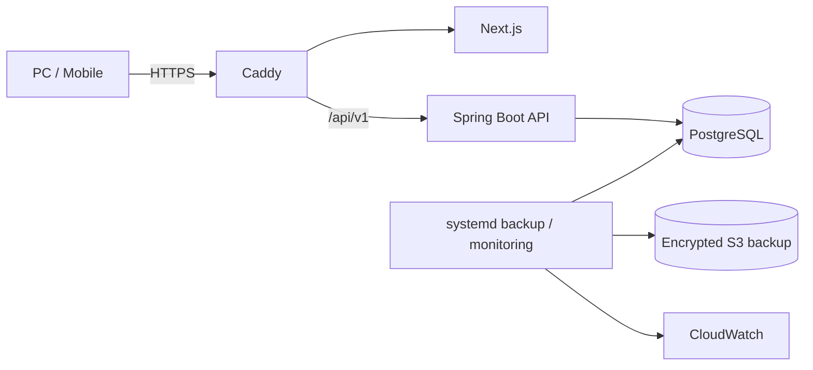

<div align="center">


# 정음 | JEONGEUM

**실제 밴드 동아리가 사용하는 합주실 예약·공연조 관리 서비스**

개인·공연조 예약부터 반복 배정·변경·교환·알림까지,  
**데이터 정합성과 운영 안정성**을 고려해 개발했습니다.

**Java 21 · Spring Boot · PostgreSQL · Next.js · Docker · AWS**

[실제 서비스](https://bandjeongeum.studio/) · [핵심 설계](#-설계에서-중점적으로-다룬-문제) · [테스트·CI](#-테스트-및-ci) · [기술 문서](#-기술-문서)

</div>

---

## 🎸 프로젝트 소개

약 **40명이 활동하는 밴드 동아리**의 회원·공연조·연습곡과 합주실 이용 일정을 한곳에서 관리하기 위해 시작했습니다. **2026년 10월 29일부터 실제 예약 앱을 공개 운영**하고 있습니다.

| 항목 | 내용 |
| --- | --- |
| **사용 대상** | 정음(JEONGEUM) 동아리의 관리자·팀장·일반 회원 |
| **담당 역할** | 개인 주도 Full-stack 개발, 백엔드 설계, 테스트, 배포·운영 |
| **개발 기간** | 2026.10 ~ 현재 |
| **서비스** | [bandjeongeum.studio](https://bandjeongeum.studio/) |
| **운영 환경** | AWS Lightsail · Docker Compose · Caddy/HTTPS · PostgreSQL |
| **기준 시점** | 아래 배포 구성·검증 수치는 **2026-11-15 KST 기록** 기준 |

> 이 문서는 채용·코드 리뷰를 위해 핵심 내용을 먼저 소개합니다. 기능의 전체 조건, 운영 이력, 모든 PR은 [기존 상세 README 보존본](docs/README_FULL_ARCHIVE_2026-11-15.md)과 [기술 문서](#-기술-문서)에 남겼습니다.

## ✅ 구현 현황

| 영역 | 주요 기능 |
| --- | --- |
| **예약·점유** | 개인 악기별 공유 예약, 공연조의 합주실 독점 예약, 취소·변경·교환 |
| **반복 배정** | 관리자 주간 고정 배정, 회차별 예외, 날짜 개방·재시작 복구 |
| **예약 정책** | 오늘 포함 31일 예약, 하루 22개 시간 블록, 개인·팀별 일반 60분 예약 한도 |
| **회원·권한** | 1회용 개인 초대 가입, 세션 인증, 전체 관리자·팀장·일반 회원 권한 |
| **알림** | 전체 공지, 개인 알림함, 기기별 Web Push, 예약 시작 1시간 전 알림 |
| **화면·운영** | PC/모바일 반응형 화면, Docker 배포, 암호화 DB 백업·독립 복원 |

기능별 예외와 실제 서버 검증 기준: [예약 운영 규칙](docs/RESERVATION_RULES.md) · [상세 구현 기록](docs/README_FULL_ARCHIVE_2026-11-15.md)

## 🔐 설계에서 중점적으로 다룬 문제

### 1. 동시 예약 시 중복 점유와 데이터 정합성

**문제** — 개인은 악기별로 합주실을 공유하지만, 공연조는 전체 공간을 독점합니다. 여러 요청이 동시에 들어오면 단순히 빈 시간인지 조회한 뒤 저장하는 방식만으로는 중복 점유를 방지하기 어렵습니다.

**해결** — PostgreSQL 트랜잭션에서 예약 날짜와 관련 행의 잠금을 명시적으로 제어하고, DB 점유 제약과 `quota_entries` 이용 한도 원장을 함께 확인합니다. 잠금 SQL과 원자적 처리를 명확하게 다루기 위해 예약 등 주요 Repository에는 **`JdbcTemplate`**을 활용했습니다.

**검증** — Testcontainers의 실제 PostgreSQL을 사용하는 통합 테스트에서 악기 충돌, 개인·팀 점유, 날짜·한도 경계 및 권한을 확인합니다.

[예약 Repository](backend/src/main/java/kr/jeongeum/scheduler/reservation/repository/ReservationRepository.java) · [통합 테스트](backend/src/test/java/kr/jeongeum/scheduler/ReservationIntegrationTest.java) · [ERD·잠금 설계](docs/ERD.md) · [PR #6](https://github.com/developer-sw/jeongeum-band-scheduler/pull/6)

### 2. 예약 변경·교환 실패 시 원본 보존

**문제** — 예약을 이동하거나 다른 사용자와 교환할 때 새 위치의 충돌·권한·한도 검증이 실패해도 기존 예약과 점유가 사라져서는 안 됩니다.

**해결** — 원본 예약을 이력으로 유지하고 새 예약과 계보로 연결합니다. 원본 점유 해제, 새 점유 생성, 한도 반영, 교환 상태를 **하나의 트랜잭션**으로 변경해 실패 시 전체 작업을 롤백합니다.

**검증** — 변경·교환의 원본 보존, 제3자 점유 충돌, 한도 및 권한·버전 충돌을 실제 PostgreSQL 기반 테스트로 검증합니다.

[예약 변경 설계](docs/RESERVATION_CHANGES.md) · [예약 교환 설계](docs/RESERVATION_EXCHANGES.md) · [PR #10](https://github.com/developer-sw/jeongeum-band-scheduler/pull/10) · [PR #12](https://github.com/developer-sw/jeongeum-band-scheduler/pull/12)

### 3. 실제 서비스의 데이터 백업과 독립 복원

**문제** — 실제 회원·예약 데이터가 저장되는 서비스에서는 DB 백업 파일의 생성뿐 아니라 **별도 환경에서의 복원 가능성**도 확인해야 합니다.

**해결** — 서울 리전의 비공개 S3에 암호화 백업을 보관하고, systemd 기반 백업·감시 실행기를 운영했습니다. 데이터 이전과 프론트엔드 단독 배포 시 기존 DB 및 볼륨 보존을 우선했습니다.

**검증** — 2026-11-15 기록 기준 실제 운영 DB의 암호문을 PC의 별도 PostgreSQL에 복원해 **39개 테이블, 29개 시퀀스, Flyway V1~V13, 22개 예약 블록**을 대조했습니다. 운영 설정 34파일도 별도 Windows 환경에 복원해 실제 서버 내용·권한과 비교했습니다.

[운영 백업·복원](docs/OPERATIONAL_DATABASE_BACKUPS.md) · [실제 데이터 이전](docs/DATA_MIGRATION_CUTOVER.md) · [운영 결과 PR #43](https://github.com/developer-sw/jeongeum-band-scheduler/pull/43)

## 🗂 프로젝트 구조

```text
jeongeum-band-scheduler/
├── backend/
│   ├── src/main/java/kr/jeongeum/scheduler/
│   │   ├── auth/           # 인증·세션
│   │   ├── reservation/    # 예약·점유·한도
│   │   ├── recurring/      # 반복 배정
│   │   ├── exchange/       # 예약 교환
│   │   ├── member/         # 회원
│   │   ├── notification/   # 알림
│   │   └── push/           # Web Push
│   ├── src/test/           # PostgreSQL 통합 테스트
│   └── src/main/resources/db/migration/
├── frontend/               # Next.js 화면·공통 API client
├── deploy/                 # 운영 Compose·Caddy·백업 자산
├── scripts/                # 로컬·운영 검증 도구
├── docs/                   # API·ERD·정책·배포·복구 문서
└── .github/workflows/      # CI 및 이미지 발행
```

### 서비스 구성



같은 HTTPS origin에서 웹 화면과 API를 제공하며, **인증·권한·예약 정책의 최종 판단은 백엔드와 DB**에서 수행합니다. 자세한 구성은 [아키텍처](docs/ARCHITECTURE.md)와 [API 명세](docs/API.md)를 확인할 수 있습니다.

## 🛠 기술 스택

| 영역 | 기술 |
| --- | --- |
| **Backend** | Java 21, Spring Boot 4.1.1, Spring MVC, Spring Security, Spring Session JDBC |
| **DB 접근** | **Spring JDBC / JdbcTemplate** (핵심 잠금·SQL), JPA 의존성·설정 |
| **Database** | PostgreSQL 17.11, Flyway V1~V13 |
| **Frontend** | Next.js 16.4.2, React, TypeScript, Tailwind CSS, TanStack Query |
| **Test** | JUnit, Testcontainers(PostgreSQL), Vitest |
| **CI / Build** | GitHub Actions, Gradle, npm, Docker Compose |
| **Operations** | AWS Lightsail, Caddy, GHCR, S3, CloudWatch, systemd, age 암호화 |

## 🧪 테스트 및 CI

**2026-11-15에 검증된 main `abb6c9b`의 CI 기록**을 기준으로 합니다.

| 검증 | 기록된 결과 |
| --- | --- |
| Backend | JUnit · Testcontainers PostgreSQL **406건 통과** |
| Frontend | Vitest **441건 통과**, 타입 검사·lint·production build |
| 운영 컨테이너 | 합성 DB를 사용한 HTTPS·권한·복원 등 **58개 검사** |
| GitHub Actions | **7개 job 모두 성공** |

[해당 CI 실행 결과](https://github.com/developer-sw/jeongeum-band-scheduler/actions/runs/43561431440) · [CI 설정](.github/workflows/ci.yaml) · [테스트 계획·검증 범위](docs/TEST_PLAN.md)

> 숫자는 해당 커밋의 **실행 기록**이며 새 코드에서 자동으로 보장되는 최신 수치는 아닙니다. 합성 QA의 Web Push 수신과 실제 운영 도메인·단말에서의 Push 수신도 구분합니다.

## 운영 배포 현황

- **2026-10-29:** 실제 데이터 이전 및 예약 앱 공개 운영 시작
- **2026-11-15 기준 운영 구성:** Frontend **rc.8** · Backend **rc.6** · Caddy **rc.3** · PostgreSQL **17.11**
- 실제 운영 DB의 암호화 백업·PC 독립 복원 및 백업·감시 자동 실행 확인
- **남은 검증:** 최신 배포 후 CloudWatch 지표·경보 독립 재조회, 실제 운영 origin의 실기기 Push 수신, 새 VM 전체 재해복구, 최신 설정 암호문의 PC 밖 추가 사본

> 독립적인 DB·선택 설정 복원을 **새 VM 전체 복구 성공** 또는 보장된 RPO/RTO로 확대해 설명하지 않습니다.

[배포 기록](docs/DEPLOYMENT.md) · [실제 서버 검증](docs/OPERATIONAL_SERVER_VALIDATION.md)

## 🚀 로컬 실행

Java 21 · Node.js/npm · Docker Desktop(Linux 컨테이너) 환경을 사용합니다. 로컬 테스트는 **격리된 Testcontainers PostgreSQL**을 사용하며 기존 실제 회원 데이터를 시험 데이터로 사용하지 않습니다.

기존 데이터가 들어 있던 개발 DB는 운영 공개 후 중지·보존 중입니다. 새로운 환경에서 실행할 때에는 **별도 DB·별도 설정**을 먼저 준비하고, 기존 볼륨이나 데이터를 임의로 초기화하지 마세요.

[환경 준비와 로컬 실행](docs/DEV_ENVIRONMENT.md) · [최초 설정](docs/INITIAL_SETUP.md) · [Backend 실행](backend/README.md) · [Frontend 실행](frontend/README.md)

## 📚 기술 문서

| 주제 | 문서 |
| --- | --- |
| 정책·구조 | [프로젝트 전제](docs/PROJECT_CONTEXT.md) · [아키텍처](docs/ARCHITECTURE.md) · [예약 규칙](docs/RESERVATION_RULES.md) |
| DB·API | [ERD / 트랜잭션](docs/ERD.md) · [API 계약](docs/API.md) · [예약 기초](docs/RESERVATION_FOUNDATION.md) |
| 변경·교환 | [예약 변경](docs/RESERVATION_CHANGES.md) · [예약 교환](docs/RESERVATION_EXCHANGES.md) · [반복 배정](docs/RECURRING_ASSIGNMENTS.md) |
| 보안·알림 | [인증](docs/AUTHENTICATION.md) · [회원/팀](docs/MEMBER_TEAM_MANAGEMENT.md) · [Web Push](docs/WEB_PUSH_REMINDERS.md) |
| 테스트·운영 | [테스트 계획](docs/TEST_PLAN.md) · [배포](docs/DEPLOYMENT.md) · [운영 백업](docs/OPERATIONAL_DATABASE_BACKUPS.md) |
| **상세 기록 전체** | [이전 README의 기능표·실행 절차·문서·PR 이력 보존본](docs/README_FULL_ARCHIVE_2026-11-15.md) |

## 🔖 개발 이력

전체 PR #1~#42 및 날짜별 기능·검증 기록은 [상세 README 보존본](docs/README_FULL_ARCHIVE_2026-11-15.md#-개발-이력)에 남겼습니다.

- [PR #6](https://github.com/developer-sw/jeongeum-band-scheduler/pull/6): 예약과 PostgreSQL 동시성 검증
- [PR #10](https://github.com/developer-sw/jeongeum-band-scheduler/pull/10) · [#12](https://github.com/developer-sw/jeongeum-band-scheduler/pull/12): 예약 변경·교환과 원본 보존
- [PR #17](https://github.com/developer-sw/jeongeum-band-scheduler/pull/17): Web Push·시작 알림·CSRF 경합 보완
- [PR #23](https://github.com/developer-sw/jeongeum-band-scheduler/pull/23) · [#31](https://github.com/developer-sw/jeongeum-band-scheduler/pull/31): 운영 컨테이너·백업
- [PR #42](https://github.com/developer-sw/jeongeum-band-scheduler/pull/42): 모바일 UI 수정 및 Docker JDK 빌드 실패 재현·복구

---

<div align="center">
  <sub>Built for JEONGEUM · SENTIMENTAL MUSIC</sub>
</div>
