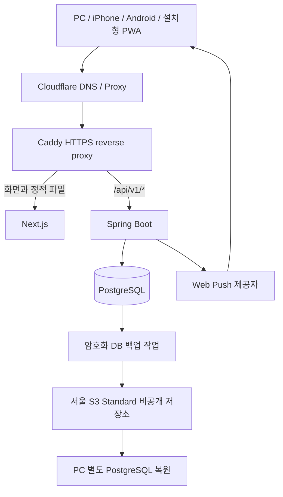

# 시스템 아키텍처

갱신일: 2026-10-26 (Asia/Seoul)

2026-10-26 후속: 기존 synthetic-only 백업과 분리한 [운영 DB 백업·독립 복원·감시](OPERATIONAL_DATABASE_BACKUPS.md)를 구현·로컬 합성 검증했다. 원본·설정·state·prefix·지표·unit을 분리하고 정확한 source/target 바인딩, snapshot 공유, 인증 후 새 빈 검증 DB 복원과 실패 시 이전 성공 보존을 검사한다. 사용자 승인으로 변경 검토·커밋·Push·main 대상 초안 PR·원격 CI 확인을 진행하며 최신 원격 결과는 해당 초안 PR의 동일 HEAD 검사를 따른다. 운영 config는 기본 비활성이며 실제 AWS/SNS·서버 systemd·운영 DB 연결은 후속이다. 기존 앱 구조·이미지·비밀값과 16/25파일 복구본·합성 백업을 보존하며 아래 미구현 설명은 당시 기록이다.

2026-10-25 현재: 일반 **Paid Plan 전환 완료**, **Basic 지원·기존 적격 크레딧 유지**를 반영한다. 적격 요금은 크레딧으로 우선 상계하지만 초과·만료·제외분은 청구될 수 있고 예산은 과금 상한이 아니다. 서버 읽기 전용 사전 점검과 [운영 설정 적용 계획](PRODUCTION_INSTALL_PLAN.md) 정리 후, 소비자별 secret 권한 구현·합성 Linux 검증을 승인받아 완료했다. AWS 재문의의 사람 답변은 별도 검토하며 아래 Free Plan 기록은 당시 이력이다.

새 [비활성 운영 설정 16파일](INACTIVE_PRODUCTION_SETTINGS.md)의 로컬 암호화·Windows 독립 복원은 완료했으나 서버에 설치하지 않았다. 관리용 원본의 root 전용 보관과 비root 런타임 secret 가독성은 구분한다. 공유 앱 DB secret의 PG init/Backend 소비자별 참조·권한은 [분리 구현과 합성 검증](RUNTIME_SECRET_PERMISSIONS.md)을 완료했다. 기존 준비 Caddy의 80/443과 합성 백업 source guard를 유지하고 rc.3 exact pins를 재사용한다. [새 25파일 암호화 복구본의 독립 복원](RUNTIME_SETTINGS_RECOVERY.md)은 완료했으며 현 synthetic-only 백업은 새 운영 DB를 보호하지 않는다. 운영 DB 백업·독립 복원·감시와 실제 설치/이전/공개는 별도 실행·승인 단계다.

2026-10-24 검증 기록: 승인된 Basic 계정·결제 문의를 접수하고 실제 VM 재부팅을 검증했다. 정확한 기존 합성 PG만 시작하는 source unit과 백업 전처리로 DB healthy 대기를 보완했으며, QA Compose·각 컨테이너의 기존 restart 정책은 유지했다. 재부팅 전후 16항목에서 DB·권한·Flyway·원본 설정·컨테이너/볼륨 보존을 확인했다. 16:00 원래 hourly 발화의 새 S3 백업과 부팅 후 metric·CloudWatch OK, HTTPS 준비 화면을 확인했다. 기존 30파일 설정 암호문에 새 3파일의 별도 보완 암호문을 더해 PC 실제 복원을 검증했다. [재부팅 검증](OPERATIONS_REBOOT_VALIDATION.md)의 완료 범위와 제한을 따른다. 당시 Free Plan을 유지했으며 지원 답변 검토·실회원 이전·앱 공개는 남아 있었다.

아래는 재부팅 검증 전 합성 정기 백업 구성 결과다. 사용자 승인으로 Free Plan을 유지하고 **서울 비공개 S3 Standard·최소 IAM·정기 age 백업·CloudWatch/SNS 경보**를 합성 DB에 구성·검증했다. 시간별 7일·주간별 28일·기본 Governance 7일을 적용하고 exact-version 재다운로드 SHA와 권한 거부, 서비스·타이머 재시작 및 축약 trigger, 실패/복구·stale ALARM/OK·양쪽 이메일 수신을 확인했다. S3 암호문의 PC 별도 PostgreSQL 복원은 10개·19.477초로 39개 테이블·29개 시퀀스·V1~V12·PG 재시작 보존을 확인했다. QA 원본 rc.2(`8b24285`)와 새 배포용 rc.3(`a00a791`)는 구분한다. 현재 공개된 것은 준비 화면이며 실제 회원 데이터 이전·예약 앱 공개는 아직 하지 않았다. 새 운영 비밀 설정 복구·전체 RPO/RTO 등 남은 경계와 추가 미수신 시험 결과는 [OPERATIONS_BACKUP_PLAN](OPERATIONS_BACKUP_PLAN.md)을 따른다.

아래 날짜별 미등록·미발행·외부 백업 미실행 설명은 당시 준비 기록이다. 현재 백업 저장소는 S3이며 R2를 새로 구성하지 않았다. 업무 정책과 앱 구조는 유지하고 실제 완료 범위는 위 최신 결과를 우선한다.

2026-10-18 기본 운영 환경: 기존 서울 VM에 고정 IPv4·공식 Docker29.9.1/Compose5.6.0·서비스 자동 시작·브라우저 SSH 전용 제한·TCP443 IPv4/IPv6를 적용/검증했다. 실제 도메인/Caddy HTTPS·앱/DB 배포·외부 백업 복구·OS 보안 패치는 후속 범위다. [AWS_LIGHTSAIL_DEPLOYMENT](AWS_LIGHTSAIL_DEPLOYMENT.md)의 최신 결과를 따른다.

2026-10-18 당시 배포 기준: 사용자가 생성한 서울 Lightsail Ubuntu 24.04·2 vCPU·4GB·80GB를 재사용하고 Free Plan 크레딧/추가 비용 최소화 조건을 반영했다. 운영 Compose 제한 합계는 2816MiB이며 실제 VM의 자원/지연 검증은 남아 있었다. `v1.0.0-rc.2` 공개 이미지·최종 digest 발행은 완료됐고 도메인은 미등록이었다. 이후 Paid 전환·도메인/준비 화면·새 rc.3 기준은 위 현재 설명과 [AWS_LIGHTSAIL_DEPLOYMENT](AWS_LIGHTSAIL_DEPLOYMENT.md)를 따른다.

이미지 공개 범위 후속: PR #24 병합 후 첫 실제 발행의 Public 상태를 확인하고 사용자가 공개 이미지 사용을 승인했다. 수동 workflow는 private/public을 명시적으로 선택하고 준비 candidate·실제 package·최종 digest 기록을 일치시킨다. 기본 private 검사는 유지하고 기존 package의 공개 범위는 자동 변경하지 않는다. [PRODUCTION_IMAGE_RELEASE](PRODUCTION_IMAGE_RELEASE.md)의 실행 기록과 제한을 따른다.

운영 이미지 발행 준비: 검증한 Linux amd64 이미지 3개를 재빌드 없이 GHCR에 전달하는 수동 workflow와 출처/CI·SHA/version·최종 manifest digest 검증을 추가한다. 준비 job은 registry 쓰기 권한이 없고 발행 job만 명시적 입력으로 활성화한다. 실제 GHCR 발행·운영 배포는 미실행이며 [PRODUCTION_IMAGE_RELEASE](PRODUCTION_IMAGE_RELEASE.md)를 따른다.

운영 컨테이너 구현 당시: Docker·Compose·Caddy 자산과 `production` 프로필, secret 파일 주입·정확한 내부 프록시 신뢰·기본 worker OFF를 구현했다. 별도 합성 DB/HTTPS의 권한·예약·앱 종료/재시작·별도 DB 복원 등 57개 검사를 통과했다. 파일별 책임과 실제 결과는 [PRODUCTION_CONTAINERS](PRODUCTION_CONTAINERS.md)를 따른다. 이 로컬 격리 구현은 운영 VPS·공개 CA·외부 백업과 실서비스 성능 검증 완료를 뜻하지 않는다.

## 1. 문서 범위와 상태

이 문서는 jeongeum-band-scheduler의 구현을 위한 설계 기준이다. 인증·명단/계정·팀/곡·예약·반복/날짜 개방·변경/교환·악기 고장·공지/알림함·Web Push/시작 알림·탈퇴/팀 해체와 가입 전/후 관리자 지정을 main에 반영했다. 개발 DB V12·기존 데이터 보존과 Backend 368건/Frontend 334건 검증 기록은 각 기능 문서와 README를 따른다. [MEMBER_TEAM_MANAGEMENT](MEMBER_TEAM_MANAGEMENT.md), [MEMBER_TEAM_LIFECYCLE](MEMBER_TEAM_LIFECYCLE.md), [WEB_PUSH_REMINDERS](WEB_PUSH_REMINDERS.md)에 구현·검증 경계를 기록했다. 합성 HTTPS 환경의 PC/iPhone 공지와 iPhone 시작 알림 수신·클릭은 확인했고 실제 운영 origin·Android·실제 운영 DB용 외부 백업/복원은 후속 범위다.

2026-10-17 사용자는 운영 배포 사전 점검·구성안 작성과 한국 접속 지연·운영 여유 우선을 승인했다. 서울 4GB 단일 VPS는 기술 권고이며 구매 확정이 아니다. 현재 구조와 운영 자산의 차이·안전한 데이터/origin 전환·배포 전 통과 조건은 [DEPLOYMENT_PREFLIGHT](DEPLOYMENT_PREFLIGHT.md)를 따른다. 사전 점검 이후 운영 Docker/Compose/Caddy는 구현·합성 검증을 완료했으며, 이미지 registry 발행과 외부 백업 자동화는 후속 범위다.

운영 정책의 기준 문서는 [PROJECT_CONTEXT.md](PROJECT_CONTEXT.md)와 [RESERVATION_RULES.md](RESERVATION_RULES.md)이다. 이 문서의 **확정 정책**은 사용자 결정의 요약이고, **기술 설계안**은 그 정책을 구현하기 위한 구조다. 세부 버전·성능 한도·설정 수치는 구현과 검증을 거쳐 고정한다.

서비스는 정음(JEONGEUM) 동아리원 약 40명의 합주실 예약과 합주 일정을 지원한다. 단일 저장소, 단일 Next.js 코드베이스, 단일 Spring 애플리케이션, PostgreSQL을 사용한다. Reormo/rehearsal-pwa는 아이디어 참고 대상이며 이 프로젝트의 코드·데이터·저장소·배포 환경과 분리한다.

## 2. 전체 구조

- 브라우저는 하나의 HTTPS origin을 사용한다. 화면과 API의 코드·컨테이너·책임은 분리한다.
- API 경로의 공통 접두사는 /api/v1이다. Caddy에서 /api/v1 요청을 Spring으로 전달한다.
- Spring이 인증·권한·예약 정책·동시성·알림의 기준을 보장한다. Next.js의 UI 검증은 사용자 편의를 위한 보조 검증이다.
- PostgreSQL은 애플리케이션 컨테이너와 별도의 컨테이너 및 지속 볼륨을 사용한다.
- 알림함·outbox·예정 알림·세션도 PostgreSQL에 보관한다. Redis, Kafka, WebSocket/STOMP, 별도 작업 서버는 초기 구조에 추가하지 않는다.
- 서버는 사용자가 생성한 서울 Lightsail 1대이며 고정 IP·Docker/방화벽 구성을 완료했다. 도메인은 미등록이고 앱/DB·HTTPS 배포는 남아 있다. 비용과 실제 이전 전 조건은 [AWS_LIGHTSAIL_DEPLOYMENT.md](AWS_LIGHTSAIL_DEPLOYMENT.md)에 기록한다.

## 3. 기술 구성

| 영역 | 설계 기준 | 책임 |
|---|---|---|
| 백엔드 | Java 21, Spring Boot, Gradle Wrapper | API와 비즈니스 규칙 |
| 웹·데이터 | Spring Web, Spring Data JPA, Bean Validation | 요청 계약, 트랜잭션, DB 접근 |
| 보안 | Spring Security, Spring Session JDBC | 인증, CSRF, 서버 세션, 인가 |
| DB | PostgreSQL, Flyway | 점유 제약, 데이터 보존, migration |
| 프론트 | Next.js, React, TypeScript | 화면과 PWA |
| 스타일 | Tailwind CSS | mobile-first 반응형 레이아웃 |
| 서버 데이터 | TanStack Query | 공통 API 조회·mutation·재조회 |
| 운영 | Docker Compose, Caddy, Cloudflare | 컨테이너 실행, HTTPS, DNS |
| 테스트 | 백엔드 핵심 테스트, PostgreSQL Testcontainers | 실제 DB 제약·동시성 검증 |

Java 21은 확정 기술이다. 초기 구성에서 공식 배포·지원 정보를 확인해 Spring Boot 4.1.1·Gradle 9.8.1, Next.js 16.4.0·React 19.3.0, PostgreSQL 17.11을 고정했다. 2026-10-23 홈 화면 반영 PR의 운영 의존성 audit 차단을 해소하기 위해 Next.js와 공식 ESLint plugin을 16.4.2로 패치했다. 의존성 버전은 BOM·명시 버전·lock 파일로 관리한다. 설치되어 있는 도구 버전을 프레임워크 버전으로 간주하지 않는다.

## 4. 구현이 유지해야 할 확정 정책

- 합주실 운영은 매일 12:00~24:00이며 요일에 따른 블록 차이는 없다. 12:00~18:00은 60분 블록 6개, 18:00~24:00은 90분 블록 4개다.
- 예약 자원은 보컬·건반·일렉기타·베이스·드럼·통기타의 6종이다. 팀 예약은 6종 전체를 점유하며, 개인 예약은 일반적으로 한 종류를 점유한다. 다른 회원은 다른 자원으로 같은 블록을 공유할 수 있지만 한 회원의 동시간대 개인 예약 두 건은 허용하지 않는다.
- 정기·추가 반복 배정은 전역 관리자가 관리한다. 배정되지 않은 시간은 선착순으로 예약한다.
- 신규 예약 가능 날짜는 한국 기준 오늘부터 14일 뒤까지이며 새 날짜는 00:00에 열린다. 반복 배정 회차를 먼저 반영하고 남은 점유를 연다.
- 60분 블록의 개인 회원별 개인 예약과 팀별 팀 예약의 하루 120분 한도는 별도 계산한다. 90분 블록은 이 60분 블록 한도를 소비하지 않는다. 관리자 고정 배정의 원래 회차·위치에서 사용하는 60분만 면제다. 단건 변경·교환으로 옮겨 만든 60분은 일반 한도를 적용하며 상대방도 면제를 넘겨받지 않는다.
- 시작 전 취소는 한도를 반환하고, 시작 후 취소는 사용한 예약의 한도를 유지한다. 실제 사용 시간이 짧더라도 예약 블록을 임의 시간으로 바꾸지 않는다.
- 블록 진행 중에도 남은 시간 이용을 위한 신규 예약이 가능하다. 예를 들어 14:10에 생성한 예약은 14:00~15:00 블록을 점유한다.
- 예약 변경·교환은 시작 전 미래 예약만 가능하다. 60분↔90분 및 두 60분 블록을 묶은 120분↔90분 교환을 허용하며, 교환에서 각 예약 주체와 악기는 유지한다. 두 60분 묶음은 같은 날 연속, 같은 개인/팀, 같은 작성자여야 한다. 교환은 기존 한도·점유·권한을 다시 검증한다.
- 서로 다른 악기의 두 60분 개인 예약이 교환으로 90분에 도착하면 두 악기를 90분 전체 점유하는 예외를 허용한다. 일반 신규 개인 예약은 한 악기다. 두 악기 90분 예외의 분할·일반 변경·직접 교환 제약은 [UX.md](UX.md)와 정책 문서의 확정 표를 따른다.
- 교환 승인자는 상대 예약자, 상대 예약 팀의 팀장, 전역 관리자다. 요청은 묶음을 포함한 모든 관련 원본 예약 중 가장 이른 시작 시점에 만료한다.
- 반복 예약의 한 회차 취소는 다음 주 배정을 끝내지 않는다. 팀 해체는 반복 배정을 종료하고 미래·진행 중 팀 예약을 취소한다.
- 회원 탈퇴는 미래·진행 중 개인 예약을 취소한다. 존속 팀의 예약은 그 생성자가 탈퇴했어도 유지한다. 팀장 후임은 전역 관리자가 지정한다.
- 관련 예약이 취소되거나 주체가 해체·탈퇴하면 해당 대기 교환 요청과 예정 알림을 종료한다. 요청자가 현재 요청 권한을 잃으면 그 요청을 무효화한다. 상대 승인 후보 한 명의 탈퇴·역할 변경만으로 다른 적법한 승인 경로가 남은 요청 전체를 무효화하지 않는다.
- 악기 고장은 그 자원을 사용하는 신규 개인 예약과 변경·교환의 새 배치 검증에 적용한다. 팀 예약은 경고와 함께 허용하며 기존 예약은 유지한다. 고장 상태가 합주실 전체 예약 차단으로 바뀌지는 않는다.
- 전체 공지는 전역 관리자가 일반 텍스트로 작성하며 고정 공지·점검 안내를 지원한다.
- 알림함, Web Push, 예약 생성 알림과 시작 1시간 전 알림을 첫 운영 범위에 포함한다.
- 회원은 정규조 여러 개와 추가조 여러 개에 소속될 수 있다. 회원·팀 관계는 팀별 멤버십으로 표현하며 회원의 정규조 수를 한 개로 제한하지 않는다. 팀별 곡 목록은 첫 운영 범위이며 수정 권한은 해당 팀장·전역 관리자다. 팀과 곡은 1:N 구조로 시작하는 기술 설계안이다.

일일 한도 계산, 예약 변경과 교환의 상태 전이 등 상세 계약은 정책 문서와 API 문서를 따른다. 아키텍처를 단순화하기 위해 위 정책을 완화하지 않는다.

## 5. 백엔드 책임 분리

단일 애플리케이션 안에서 기능 단위 패키지를 사용한다. 각 기능에 controller, service, repository, domain, DTO를 두되 실제 필요한 경계만 만든다.

| 기능 경계 | 주요 책임 |
|---|---|
| auth / invitation / member | 로그인·초대 소비·회원 상태·역할 |
| roster | 가입 전 명단, 일대일 계정 연결, 명단 기반 소속 |
| team / song | 관리자 팀 구성, 팀원·팀장·곡 관계 |
| schedule / reservation | 블록 조회, 점유, 개인·팀 예약, 한도 |
| recurring-assignment | 반복 배정, 회차 생성·예외 취소 |
| exchange-request | 교환 신청·승인·거절·만료·원자적 교환 |
| notice / instrument-fault | 전체 공지, 악기 고장·복구 |
| notification / push-subscription | 알림함, 구독, outbox, reminder |
| common | API 오류, 공통 보안 설정, 시간 제공, 최소 운영 설정 |

Controller는 입력을 읽고 인증된 사용자와 DTO를 서비스에 전달한다. 서비스가 정책·권한·트랜잭션을 다룬다. Repository는 조회·잠금·저장을 맡고 Domain은 허용 상태와 의미를 표현한다. 동일 정책을 Controller와 프론트에 각각 구현하지 않는다.

DB migration은 Flyway로 관리하고, 운영에 적용된 파일은 수정하지 않고 새 migration을 추가한다. 운영 Hibernate ddl-auto는 구조 자동 변경에 사용하지 않는다. migration은 배포 시 하나의 실행 주체가 수행한다.

## 6. 인증과 초대

### 6.1 서버 세션

기술 설계안은 Spring Security + Spring Session JDBC다. 세션 데이터는 PostgreSQL에 저장하고 브라우저는 세션 ID 쿠키만 가진다. 이 규모에서 토큰 갱신·폐기 시스템을 별도로 만드는 Cookie JWT 구조보다 운영 경계가 단순하다.

- 운영 인증 쿠키는 Secure, HttpOnly, SameSite=Lax를 사용한다. 불필요한 Domain 범위를 지정하지 않는다.
- 로그인 성공 시 세션 ID를 갱신하고 로그아웃 시 서버 세션을 무효화하고 쿠키를 제거한다.
- 회원 차단·탈퇴·권한 회수는 기존 로그인 세션에 반영한다. 세션에 담은 예전 역할만으로 접근을 허용하지 않는다.
- 서비스는 현재 회원 상태와 대상 팀의 현재 소속·팀장 여부를 검증한다. 민감한 변경 권한은 예약 트랜잭션 안에서도 재검증한다.
- 세션에는 필요한 식별 정보만 넣는다. 2026-10-10 사용자 확정으로 마지막 접속 후 90일 동안 로그인을 유지하며 인증 요청에서 DB 만료와 영속 쿠키 만료를 함께 연장한다. 로그인·로그아웃·회원 비활성화·탈퇴의 해제 및 서버 재시작 복원은 [AUTHENTICATION](AUTHENTICATION.md)에 기록한다. 활성 기기 수 제한과 직렬화 형식의 배포 호환성은 별도 검증 항목이다.
- API 미인증·권한 부족은 JSON 오류를 반환한다. UI 로그인 페이지로의 서버 리다이렉트에 의존하지 않는다.

[Spring Session JDBC 공식 문서](https://docs.spring.io/spring-session/reference/configuration/jdbc.html), [Spring 세션 관리](https://docs.spring.io/spring-security/reference/servlet/authentication/session-management.html)

### 6.2 개인별 일회용 초대

회원 탈퇴와 로그인 완료의 경합은 `LoginSessionService`가 비밀번호 검증 이후의 현재 회원 재검사·세션 게시를 directory guard와 같은 짧은 트랜잭션에 넣어 보호한다. 종료 정리의 잠금·원자성·동일 요청 재확인 계약과 실제 검증은 [MEMBER_TEAM_LIFECYCLE](MEMBER_TEAM_LIFECYCLE.md)을 따른다. 이미 외부 제공자에 전송 중인 Push를 회수하거나 탈퇴자의 재조회 권한을 복구하지 않는다.

전역 관리자가 개인별 초대를 발급한다. 추측하기 어려운 임의 토큰을 사용하고 DB에는 원문 대신 hash, 만료 시각, 소비 시각, 발급자를 보관한다. 가입 시 만료·미사용 여부를 확인하고 계정 생성과 토큰 소비를 한 트랜잭션에서 처리해 중복 소비를 막는다. 재발급 시 기존 미사용 초대를 폐기한다.

승인된 인증 구현은 **기술 제안**인 loginId + password + 표시 이름을 사용하며 SMTP·이메일 인증 서비스를 추가하지 않는다. 사용자 확정 운영 정책과 구분하고 세부 입력·초대 만료 설정은 [AUTHENTICATION](AUTHENTICATION.md)에 기록한다. 이메일 로그인으로 정했다면 API·회원 모델을 그 결정에 맞춰 수정한다.

비밀번호는 Spring PasswordEncoder의 adaptive hash를 사용하고 실행 환경에서 검증 비용을 조정한다. 공용 초기 비밀번호를 배포하거나 평문 비밀번호를 저장하지 않는다.

초대·세션·비밀번호·R2·VAPID 원문은 로그, Git, API 오류, 분석 도구에 기록하지 않는다. 초대 화면은 접근 URL과 요청 본문에서 토큰이 로그에 남지 않도록 구성하고 분석·캐시 대상에서 제외한다.

[Spring 비밀번호 저장](https://docs.spring.io/spring-security/reference/features/authentication/password-storage.html)

### 6.3 CSRF·CORS·XSS

- 동일 origin이어도 CSRF를 유지한다. CSRF 토큰은 인증 쿠키와 별개의 값이며 /api/v1/auth/csrf에서 가져와 변경 요청 헤더에 전달한다.
- 로그인·로그아웃 뒤 새 CSRF 토큰을 얻는다. 실제 선택 버전의 SPA 토큰 처리·BREACH 보호·갱신 방식에 맞춰 구현한다.
- 운영에서는 브라우저가 다른 origin의 API를 호출할 이유를 만들지 않는다. 로컬도 /api 경로 전달을 우선하며 별도 origin 개발을 허용할 경우 개발 origin만 명시한다.
- 인증 쿠키를 쓰는 요청에 임의 origin + credentials 허용을 적용하지 않는다. preflight는 인증 검사보다 먼저 처리한다.
- React의 일반 텍스트 렌더링을 사용하고 공지에 임의 HTML을 허용하지 않는다. 보안 헤더와 CSP는 프레임워크 동작을 확인하며 적용한다.
- HttpOnly는 JavaScript의 쿠키 읽기를 제한하지만 XSS 자체를 해결하지 않으므로 출력 처리·의존성 관리·CSP도 필요하다.

[Spring CSRF](https://docs.spring.io/spring-security/reference/servlet/exploits/csrf.html), [Spring CORS](https://docs.spring.io/spring-security/reference/servlet/integrations/cors.html)

## 7. 인가와 예약 주체

전역 역할 `GLOBAL_ADMIN`은 개발자와 임원진(회장·부회장·총무·매니저)이다. 팀장은 특정 팀의 소속 역할이며 `GLOBAL_ADMIN`과 동시에 보유할 수 있다. 팀장이라는 이유만으로 다른 팀을 관리하지 않는다.

- 전역 관리자는 팀 생성·팀원 등록·팀장 지정·반복 배정·전체 공지·악기 고장/복구를 관리한다.
- 일반 개인 예약은 활성 본인, 일반 팀 예약은 해당 팀에 소속된 활성 팀원이 생성한다. 전역 관리자라는 이유만으로 미소속 팀의 일반 예약을 대리 생성하지 않는다. 관리자 반복 배정과 일반 예약 생성의 권한을 구분한다.
- 개인 예약의 주체는 회원, 팀 예약의 주체는 팀이다. 생성자와 예약 주체를 분리한다. 관리자가 배정한 팀 예약도 주체가 관리자로 바뀌지 않는다.
- 예약자·해당 팀장·전역 관리자의 변경·취소 권한과 상대 예약의 교환 승인 권한은 API와 서비스 양쪽에서 검증한다.
- actor ID, 예약 주체, 역할, 관리자 여부를 요청 본문이 주장한 값으로 인정하지 않는다. actor는 인증 정보에서 결정한다.
- API의 전역 역할 검사와 서비스의 대상 자원 검사로 나누어 인증만 된 사용자가 다른 회원 예약·다른 팀 관리 API를 호출하는 것을 막는다.
- 취소·변경·승인·관리자 배정에는 처리자·시각·사유와 필요한 이전 상태를 기록한다. 회원 탈퇴나 팀 해체를 DB 연쇄 삭제로 처리해 예약 이력이 사라지게 하지 않는다.

회원 탈퇴 뒤 존속 팀 예약의 처리 권한은 현재 팀장·전역 관리자 등 유효한 운영 권한으로 처리하며, 탈퇴 생성자의 과거 기록에 권한을 부여하지 않는다.

[Spring Method Security](https://docs.spring.io/spring-security/reference/servlet/authorization/method-security.html)

## 8. 예약 트랜잭션과 동시성

단건 예약 변경의 실제 구현은 [RESERVATION_CHANGES](RESERVATION_CHANGES.md)를 따른다. V6 계보와 원본 REPLACED·후속 CHANGE 예약, 점유·quota ledger·회차 예외·재시도 기록을 하나의 10초 트랜잭션으로 저장한다. 아래 교환·알림 outbox 설계는 아직 후속 구현이며 현재 변경 API가 Push 발송을 완료한다는 의미가 아니다.

조회 화면에서 빈 시간을 확인한 뒤 다른 사용자가 선점할 수 있으므로 예약 성공 여부는 DB 커밋에서 결정한다. UI의 예약 가능 표시만으로 중복을 방지하지 않는다.

기술 설계안의 불변조건은 다음과 같다.

1. 허용 블록, 주체, 악기 고장 상태, 날짜와 시작 조건을 서버에서 검증한다.
2. 명단·권한·초대·가입 변경과 이번 예약 생성·취소는 `directory_mutation_guard`를 먼저 잠근다. 현재 권한을 재검증한 뒤 주체뿐 아니라 실행자·승인자를 포함하는 관련 회원 행, 관련 팀 행을 각각 ID 오름차순으로 `FOR NO KEY UPDATE` 잠그고, 악기 행 → 반복 관리·생성 작업이면 recurring_schedule_guard → booking_days 날짜 행 → 예약 행 순으로 잠그는 기술안을 따른다. 새 개인 배치의 고장 검증은 악기 행을 `FOR SHARE`, 고장 등록·복구는 `FOR UPDATE`로 잠근다. 없는 날짜는 guard 안에서 생성한 뒤 잠근다. 각 단계 안에서는 ID 또는 날짜 오름차순을 사용하고 날짜 행은 `FOR UPDATE`로 한도와 점유 변경을 직렬화한다. 필요한 가장 강한 모드를 처음부터 선택해 뒤늦은 잠금 승격을 피한다.
3. 10개 고정 블록은 서로 겹치지 않으므로 30분 atomic slot을 추가하지 않는다. reservation_assets의 활성 점유에 대한 partial unique(reservation_date, time_block_code, asset_id)가 최종 점유 방어선이다. 팀은 6자원 전체, 개인은 일반 1자원 또는 허용된 90분 2자원 예외를 점유한다. 동일 회원의 같은 블록 개인 중복은 별도 제약·잠금으로 방어한다.
4. 두 블록 묶음은 모든 점유가 함께 성공하거나 함께 롤백된다. 부분 성공 예약을 만들지 않는다.
5. 변경·교환에서는 회원·팀 → 악기 → 사용 날짜 → 예약 ID 순으로 잠그고 예약 version을 재검증한다. 원래 예약과 목적 점유·각 주체의 한도·현재 권한을 한 트랜잭션에서 반영한다. 팀원·팀장 변경과 회원·팀 비활성화도 관련 회원·팀 잠금 규칙을 공유해 권한 회수와 예약 변경의 경합을 처리한다. 재조회한 날짜·자원 집합이 이미 취득한 잠금 범위와 달라지면 역순 잠금을 추가하지 않고 트랜잭션을 다시 시작한다.
6. 교환 승인 시 승인 이전에 본 조회 결과를 신뢰하지 않고 두 예약의 버전·상태·시작 시각·악기·요청 만료를 다시 확인한다.
7. 중복 점유·한도 초과·변경된 대상·만료된 요청은 일관된 API 오류로 반환하고 클라이언트가 다시 조회하게 한다.
8. 예약 상태 변경, 교환 상태 변경, 반복 회차 예외, 알림 outbox 생성은 동일 DB 트랜잭션에서 기록한다.

실제 시간·자원 배치를 바꾸는 변경은 원본 예약을 REPLACED 이력으로 남기고 successor 예약을 생성하는 설계다. 예약 주체와 원래 생성자는 유지하며 변경·승인 actor는 별도의 감사 기록으로 남긴다. 1↔2 교환은 원본과 후속 예약의 N:M lineage로 연결한다. 새 DB 행이 생긴 사실과 사용자에게 의미 있는 예약 사건은 구분한다.

날짜·블록·자원이 모두 같은 no-op PATCH는 원래 예약을 유지한다. 기존 고장 상태의 예외, 한도 면제 출처, 대기 교환, 예정 알림을 불필요하게 바꾸지 않는다. 대기 교환의 유효성은 원본 source IDs와 version으로 판단하고 실제 변경에서 무효화한다. 고장 등록과 새 배치 검증의 경합도 자원 잠금을 포함한 ERD의 공유 잠금 규칙으로 처리한다.

새 날짜는 반복 배정 회차를 먼저 생성하고 개방 완료 상태를 기록한 뒤 선착순 예약에 공개한다. 반복 회차 unique와 날짜 잠금으로 재실행·재시작·여러 스케줄러의 중복 생성을 막는다. 회차별 변경·취소·교환 예외를 보존하고 서버가 00:00에 중단되었으면 다음 실행에서 필요한 날짜를 복구한다. 새 반복 배정과 기존 예약이 충돌하면 배정 적용을 거절하고 기존 예약을 유지한다.

아직 날짜 행이 없는 미래 주간 패턴의 동시 편집은 날짜 mutex만으로 보호되지 않는다. 기술안은 단일 `recurring_schedule_guard` 행을 패턴 생성·변경·종료에서 FOR UPDATE, 날짜 개방·회차 생성에서 FOR SHARE로 보호하는 것이다. 해당 작업의 잠금 순서는 users/teams → assets → recurring_schedule_guard → booking_days → reservations다. 일반 예약에는 이 guard를 추가하지 않는다. 패턴 재조회로 대상 팀·날짜 집합이 달라지면 공통 규약에 따라 최신 계획으로 다시 시작한다.

잠금·unique·버전 충돌의 구체적인 조합은 [ERD.md](ERD.md)의 계약을 PostgreSQL Testcontainers 테스트로 검증한다. `FOR NO KEY UPDATE`는 알림 수신자 FK의 `KEY SHARE`와 충돌하지 않게 선택한 기술안이며, ORM이 실제로 생성한 잠금 SQL도 확인한다. 서비스 메모리 잠금만으로 보장하거나 예약 점유를 Redis에만 보관하지 않는다.

## 9. 알림함·Web Push·예정 알림

### 9.1 영속 이벤트와 전달 분리

예약 트랜잭션이 Push 제공자 호출의 성공을 기다리게 하지 않는다. 예약 변경·알림 사건·수신자별 알림함 항목·Push 발송 outbox를 하나의 DB 트랜잭션에 기록하고, 같은 Spring 애플리케이션의 작업자가 커밋 후 외부 Push 전달을 처리한다. 롤백하면 예약 변경과 알림 기록도 함께 롤백한다.

- 사건은 고유 event ID, 대상 예약 ID, 예약 revision, 사건 종류, 발생 시각을 갖는다.
- 변경·교환은 successor 행 수와 상관없이 논리 CHANGED/EXCHANGED 사건을 만든다. successor마다 CREATED 알림을 추가 발송하지 않는다. 원본·후속 예약 관계를 통해 실제 활성 예약과 연결한다.
- 반복 배정에서 최초로 생성한 실제 회차는 CREATED 사건이다. 같은 회차 생성 작업의 재실행을 새 사건으로 만들지 않는다.
- 알림함은 event ID + 수신자 ID의 unique 제약으로 작업 재시도 시 중복 생성을 막는다.
- Push 전달은 event ID + 수신자 구독 ID를 delivery key로 사용해 완료·재시도 상태를 기록한다.
- 작업자는 DB 행의 상태와 lease를 사용해 동시에 같은 일을 처리하지 않게 하고 실패 시 제한된 재시도·다음 시각을 기록한다.
- 전달 직전 현재 예약 revision·상태와 현재 수신 자격을 확인한다. 만료된 구독은 비활성화하고 일시 실패와 영구 실패를 구분한다.
- 네트워크 타임아웃 후 실제 전송 성공 여부가 불명확할 수 있으므로 외부 Push의 exactly-once를 보장한다고 설명하지 않는다. 전송은 재시도 가능하며 브라우저 notification tag와 사건 식별자로 중복 표시를 줄인다.
- 예약 처리 성공은 외부 Push 실패로 롤백하지 않는다. 알림 실패는 운영 로그·알림 작업 상태로 확인하고 알림함을 기준 기록으로 사용한다.

### 9.2 수신자와 개인정보

일반 팀 예약 사건은 현재 활성 팀원, 개인 예약 사건은 해당 회원이 수신한다. 전역 관리자 모두에게 일반 예약 사건을 무조건 발송하지 않는다. 전역 관리자도 해당 팀원이면 팀 사건을 수신한다. 교환은 관계자, 중요 전체 공지는 활성 회원 전체에 알린다. 상세 사건별 대상은 [NOTIFICATIONS.md](NOTIFICATIONS.md)를 따른다.

구독은 인증된 사용자와 기기를 연결하고 등록·해제 API도 CSRF와 본인 권한으로 검증한다. 구독 endpoint와 키는 다른 회원에게 노출하거나 로그에 출력하지 않는다. 서버는 발송 목적지 URL을 검증하고 임의 내부 주소를 Push endpoint로 호출하지 않는다. 계정 전환 시 이전 계정의 구독으로 새 계정의 알림이 전달되지 않게 한다. Push는 간단한 안내와 내부 경로를 담고, 상세 조회 시 로그인·현재 자원 권한을 다시 확인한다.

**2026-10-14 사용자 확정:** 로그아웃한 해당 기기의 구독을 중단하고 다른 기기의 구독은 유지한다. 현재 세션 기기 binding과 대기 발송 종료·계정 전환 보호의 구현은 [WEB_PUSH_REMINDERS](WEB_PUSH_REMINDERS.md)를 따른다.

Push 권한 거부나 브라우저 제한에도 사이트를 사용하고 알림함을 확인할 수 있다. PWA 설치나 알림 허용을 예약 기능의 필수 전제로 만들지 않는다.

[W3C Push API](https://www.w3.org/TR/push-api/), [MDN Push 구독](https://developer.mozilla.org/en-US/docs/Web/API/PushManager/subscribe)

### 9.3 시작 1시간 전 알림

- 예약 생성·변경 트랜잭션에서는 `REMINDER_PLAN`만 저장한다. due 시점의 검증 트랜잭션에서 실제 알림함 항목과 구독별 `PUSH_DELIVERY`를 만든다. 미래의 시작 안내를 현재 알림함에 미리 노출하지 않는다. 한 기기의 전송 성공을 다른 기기의 성공으로 기록하지 않는다.
- dueAt은 실제 예약 블록 시작 시각의 1시간 전이다. 예약 직전 생성되어 이미 dueAt이 지난 경우 생성 알림을 보내고 지난 reminder를 뒤늦게 생성하지 않는다.
- 변경·교환 시 이전 revision의 미전송 reminder를 무효화하고 새 시작 시각으로 다시 계획한다. 새 dueAt이 미래인 경우에만 새 reminder를 계획한다.
- 중복 판단은 물리 reservation ID가 아니라 동일 논리 예약 계보 + 실제 시작 시각을 기준으로 한다. 같은 시작 시각의 악기 변경은 이전 미전송 계획만 대체하며 이미 발송한 시작 알림은 다시 보내지 않는다. 1↔2 N:M lineage에 사용할 정규 식별키는 ERD와 맞추고 병합·분할·원래 시간 복귀 사례로 검증하는 기술 설계안이다.
- 취소·팀 해체·개인 탈퇴에 따른 취소는 관련 미전송 reminder를 종료한다.
- reminder 실행 시 현재 예약 상태·revision·시각·수신자를 재검증한다. 서버 재시작 후에도 DB에 남은 작업을 읽고, 시작 시각이 지난 작업은 발송하지 않는다.
- reminder의 동일 사건·동일 수신자 중복은 알림함 unique와 delivery key로 줄인다. 변경과 전송이 겹친 외부 전송의 순서를 완전히 보장할 수는 없으므로 알림 클릭 뒤 최신 상태를 조회한다.

예약 시작 후 한도 유지와 진행 중 예약 생성의 시간 판단은 알림 시간과 함께 테스트할 수 있도록 서버 시간 제공자를 주입 가능한 구조로 둔다.

## 10. 프론트와 PWA

하나의 Next.js 코드베이스를 사용한다. 기능 단위의 API client, Query hook, 화면 컴포넌트를 분리하고 TypeScript 요청·응답 계약을 공유한다.

- 모바일은 날짜 선택 + 하루 시간 목록, PC는 넓은 주간 시간표를 사용한다. 공통 조회 결과를 다른 UI로 표현하며 예약 정책·API 호출을 두 벌 만들지 않는다.
- 예약 mutation 성공 후 관련 일정·내 예약·알림을 invalidate/refetch한다.
- 초기 동기화는 활성 화면에서 15~30초 polling과 focus 재조회로 설계한다. 숨겨진 화면의 불필요한 polling은 줄인다. 정확한 주기는 사용성과 서버 부하 측정 후 고정한다.
- 서버 확정 전 예약 성공을 확정 표시하지 않는다. 충돌 응답을 받으면 현재 일정을 다시 조회하고 선택을 안내한다.
- 로그인 상태에 따라 달라지는 Next.js HTML/RSC, API 응답, 개인정보를 CDN·서버 공용 캐시에 저장하지 않는다. 로그아웃·계정 전환 시 TanStack Query의 사용자 데이터를 비운다.
- manifest, 앱 아이콘, standalone, service worker, offline fallback, Web Push를 준비하고 실제 iPhone Safari·Android Chrome에서 검증한다.
- service worker는 명시적으로 허용한 정적 파일과 offline 안내만 캐시한다. 인증 API와 개인화 HTML/RSC, 초대·로그인 화면 데이터는 캐시하지 않는다.
- offline에서는 예약·변경·취소·교환을 실행하거나 자동 재전송하지 않는다. 연결 복구 후 서버 상태를 다시 조회한다.

Cache API는 HTTP 캐시 헤더를 자동 준수하지 않으므로 no-store만 설정하고 끝내지 않고 service worker 허용 목록에서도 제외한다. [MDN Cache API](https://developer.mozilla.org/en-US/docs/Web/API/Cache)

## 11. 시간·오류·로그

- 운영 정책의 날짜와 일일 한도는 Asia/Seoul 기준이다. 클라이언트 기기의 현재 시각을 서버 정책 판단에 사용하지 않는다.
- 24:00은 화면 표현이며 실제 종료 시점은 다음 날짜 00:00이다. DB·API에서 날짜 경계를 명확히 표현한다.
- 시스템 사건의 시각은 일관된 시각 타입으로 보관하고 API에 timezone/offset 의미가 분명한 값으로 전달한다.
- 오류 응답은 일관된 code, 사용자 안내 메시지, 필요한 필드 오류와 request ID를 사용한다. DB 제약 이름·SQL·stack trace·secret을 사용자에게 반환하지 않는다.
- 예약 ID·actor ID·사건 ID·request ID 중심의 구조화 로그를 사용한다. 로그인·초대·Push·백업 secret은 기록하지 않는다.

## 12. 검증과 남은 확인

최소 검증은 PostgreSQL 기반 동시 예약·묶음 부분 실패·한도 경합·변경·교환, CSRF·미인증·다른 팀 접근 거부, 진행 중 예약·취소 경계, 자동 취소와 알림 재계획, 재시작 후 작업 복구, 모바일/PWA·offline을 포함한다.

로그인 식별자·초대 설정·90일 로그인 유지의 현재 계약은 [AUTHENTICATION](AUTHENTICATION.md)을 따른다. 아직 확인할 사항은 로그아웃 후 해당 기기 Push 수신 정책, polling 주기, 작업 재시도 한도, 배포 자원 실측이다. 새로운 사용자 운영 규칙과 기술 설정값을 구분하고, 구현 단계에서는 확정 정책을 변경하지 않고 필요한 설정을 검증한다.

운영 적용은 [설치 계획](PRODUCTION_INSTALL_PLAN.md)의 소비자별 secret 권한·기존 edge 인계·운영 백업 선행 조건을 충족한 뒤 별도 승인 범위에서 수행한다. worker OFF를 DB 무변경이나 사용자 쓰기 차단으로 간주하지 않는다. 새 쓰기 허용 후에는 최신 운영 데이터를 보존한 복구 계획이 필요하다.
