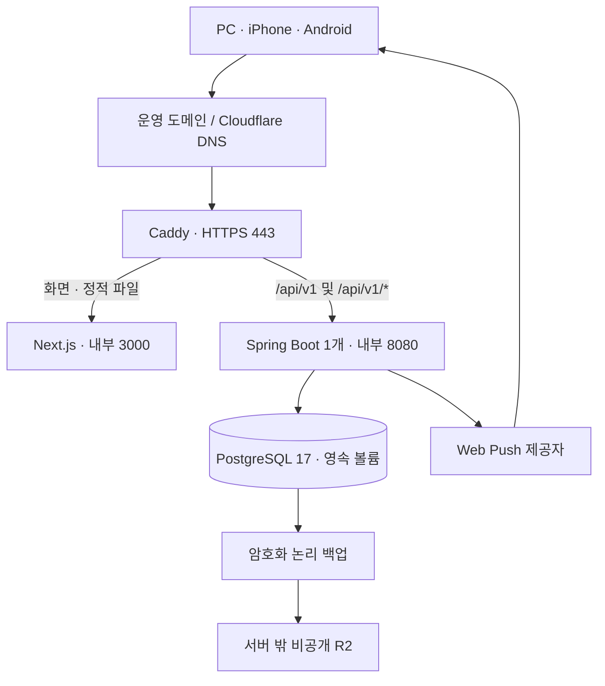

# 운영 배포 사전 점검과 구성안

점검일: 2026-10-17, Asia/Seoul. 기준: `main`의 `bf2a474`(PR #21 기능·PR #22 README 병합). 작업 브랜치: `codex/deployment-preflight`.

후속 구현: 이후 사용자 승인으로 운영 컨테이너 자산·격리 합성 통합 검증을 진행한다. [PRODUCTION_CONTAINERS](PRODUCTION_CONTAINERS.md)가 최신 구현/결과이며 아래 ‘아직 없음/미구현/미실행’은 이 사전 점검 당시 상태다. 실제 운영 구매·데이터 이전·공개 배포 승인은 구분한다.

## 1. 결론과 승인 경계

핵심 기능의 로컬·합성 환경·CI 검증과 실제 운영 환경의 준비는 구분한다. 현재 코드는 운영 구성을 준비할 기반이 있지만, 운영 이미지·HTTPS 프록시·외부 백업·새 도메인 Push 전환이 미구현/미검증이므로 **바로 운영 개방하는 단계는 아니다**.

- **사용자 확정:** 한국 접속 지연과 운영 여유를 비용 최저화보다 우선한다. 기존 계정·명단·팀·팀장·관리자 지정·곡·예약과 데이터 볼륨을 보존한다.
- **기술 권고:** 서울 리전 Linux x86_64 VPS 1대, 2 vCPU·4GB RAM·80GB SSD를 기준으로 Caddy·Next.js·Spring Boot·PostgreSQL을 Docker Compose로 운영한다. AWS Lightsail은 이 기준의 우선 비교 후보이며 공급자·구매 예산 확정은 아니다.
- **이번 수행:** 코드·문서의 읽기 전용 감사, 공식 가격/기술 문서 조회, 구성안과 배포 전 통과 조건 작성. 실제 `.env`·비밀키·덤프 본문은 읽지 않았다. DB 조회·백업 생성·복원·서버/worker 기동·부하 시험은 하지 않았다.
- **후속 승인 범위:** 운영 자산 구현·검증, GitHub 반영, 도메인 구매·계정/서버/저장소 생성·비용 발생·실제 데이터 이전·배포는 이번 문서 작성만으로 실행하지 않는다.

예약·권한 정책은 [PROJECT_CONTEXT](PROJECT_CONTEXT.md)와 [RESERVATION_RULES](RESERVATION_RULES.md)를 따른다. 아래 공급자·리소스·백업 주기·복구 목표는 기술 권고이며 새로운 업무 정책 확정이 아니다.

## 2. 현재 상태와 배포 전 보완점

| 영역 | 확인한 근거 | 현재 판정과 다음 작업 |
|---|---|---|
| 기능 검증 | PR #21 HEAD `44c9fab`의 Push/PR 4 jobs, 병합 `f9369d7`의 main 2 jobs 성공 | Backend 20 suites·368건, Frontend 23파일·334건·타입/lint/빌드. 새 VM의 용량·지연 증거는 아님 |
| DB·회원 보존 | [회원 관리](MEMBER_TEAM_MANAGEMENT.md)의 V12 적용·격리 복원 기록 | 이전 단계에서 확인한 결과. 이번 DB 재조회는 없으며, 이전 직전의 **새 V12 백업** 필요 |
| 운영 실행 자산 | 저장소 파일 목록, [개발 Compose](../compose.yaml), [백엔드 스크립트](../scripts/Start-Backend.ps1), [프론트 스크립트](../scripts/Start-Frontend.ps1) | 개발 DB와 `bootRun`/`next dev`만 준비됨. 운영 Dockerfile·Compose·Caddyfile·이미지 발행 경로 필요 |
| HTTPS 세션 | [application.yaml](../backend/src/main/resources/application.yaml), [SecurityConfiguration](../backend/src/main/java/kr/jeongeum/scheduler/common/security/SecurityConfiguration.java) | 기본 Secure·HttpOnly·SameSite=Lax·90일·CSRF 있음. Secure=false인 `local` 프로필을 운영에 사용하지 않음 |
| 프록시·네트워크 | [next.config.ts](../frontend/next.config.ts), [API client](../frontend/src/lib/api/client.ts) | 상대 API 경로는 단일 origin과 호환. 내부 bind·빌드 시 API origin·신뢰 헤더·캐시 제외 설정 필요 |
| 날짜 개방·작업자 | 반복/교환 worker는 기본 ON, Reminder/Push worker와 Push 기능은 기본 OFF | 복원·행 대조 중에는 **네 worker 모두 OFF**, 단계별 활성 검증 필요 |
| Push 전환 | [V10 schema](../backend/src/main/resources/db/migration/V10__web_push_and_reminders.sql), [발송 저장소](../backend/src/main/java/kr/jeongeum/scheduler/push/repository/PushDeliveryRepository.java), [브라우저 구독](../frontend/src/features/push/browser.ts) | 구독에 origin/VAPID key ID 구분 없음. 이전 구독·대기 발송 처리 절차가 준비되기 전 실발송 금지 |
| 관측·복구 | [HealthController](../backend/src/main/java/kr/jeongeum/scheduler/health/controller/HealthController.java), CI workflow | health는 DB 연결만 확인. 외부 백업·작업 실패/지연·자원 관측·운영 재시작/롤백 증거 필요 |
| PWA·실기기 | [manifest](../frontend/src/app/manifest.ts), [Push 검증 기록](WEB_PUSH_REMINDERS.md) | 합성 HTTPS의 PC/iPhone 수신·클릭은 확인. 운영 origin·Android·실제 접근성 검증은 남음. SW는 Push 전용이며 오프라인 최초 실행 fallback은 없음 |

기존 CI: [기능 Push](https://github.com/developer-sw/jeongeum-band-scheduler/actions/runs/38900217557), [기능 PR](https://github.com/developer-sw/jeongeum-band-scheduler/actions/runs/38900246980), [병합 main](https://github.com/developer-sw/jeongeum-band-scheduler/actions/runs/38931057265). 이 문서 작성 때문에 테스트를 재실행하거나 운영 검증 완료로 집계하지 않는다.

## 3. 권장 운영 구성

이 그림은 제안 구조다. 서버·DNS·버킷을 만들거나 연결한 상태를 뜻하지 않는다.

| 구성 | 권장 경계 |
|---|---|
| 서버 | 서울 리전 Linux x86_64, 4GB 기준. 이미지 빌드는 CI/별도 builder에서 수행하고 VM에서는 실행만 함 |
| HTTPS | Caddy 인증서 데이터 볼륨 보존. 초기 DNS-only로 직접 HTTPS를 검증하고, Cloudflare Proxy는 Full (strict)·신뢰 IP·캐시 제외를 검증한 뒤 적용하는 순서 권고 |
| 공개 포트 | 외부 앱 접근은 TCP 80/443. SSH는 관리 IP와 키 인증으로 제한. 3000/8080/5432의 호스트 공개 없음; IPv6에도 같은 경계 적용 |
| 내부 라우팅 | `/api/v1` 및 하위 경로를 **접두사 제거 없이** Spring으로 전달. 나머지는 Next.js. API를 SPA HTML로 fallback하지 않음 |
| DB | 개발과 다른 자격증명·새 운영 볼륨·내부 네트워크. 기존 개발 볼륨은 보존. 앱에는 클러스터 superuser를 주지 않고 migration에 필요한 권한을 별도로 점검 |
| 앱 | Next 1개·Backend 1개. Next runner는 내부 0.0.0.0:3000에 bind하고 호스트에는 publish하지 않음. Java 21·Node 24 계열과 lockfile 기반 Linux 이미지를 고정하고 실행 digest를 기록. 실제 이미지 tag/digest는 구현 때 선정·검증 |
| 자원 | 4GB 중 OS·백업·장애 대응 여유를 남기고 JVM heap/RSS·Node·DB를 함께 측정해 제한 결정. Gradle의 `-Xmx512m`은 운영 JVM 제한이 아님 |
| 지속성 | PostgreSQL 데이터, Caddy 인증서, 운영 비밀키/복구 자료를 앱 이미지와 분리. 앱 교체로 DB 볼륨을 재생성하지 않음 |
| 운영 복잡도 | 단일 VPS의 장애 지점은 남는다. Redis·Kafka·Kubernetes·다중 Backend를 이번 구성에 추가하지 않음 |

서울 4GB는 사용자 우선순위에 따른 여유 있는 **시작 후보**다. 회원 약 40명이라는 수치만으로 처리량이나 장애 없는 운영을 보장하지 않는다. 시간표 조회·예약 경합·Push 작업·백업 동시 실행에서 지연/메모리/OOM/디스크를 측정한다.

### 가격 비교 — 2026-10-17 공개 자료 확인

| 후보 | 사양 | 월 서버+IPv4 | 2개월 서버 | 일반 .cloud 첫해 할인 포함 참고 합계 |
|---|---|---:|---:|---:|
| **우선 권고: Lightsail 서울** | 2 vCPU·4GB·80GB | **$24** | **$48** | **$51.88** |
| 비용 절감 대안: Lightsail 서울 | 2 vCPU·2GB·60GB | $12 | $24 | $27.88 |
| 기존 비교안: Hetzner 유럽 CX23 | 2 vCPU·4GB·40GB | $6.49+$0.60=$7.09 | $14.18 | $18.06 |

출처: [Lightsail 가격](https://aws.amazon.com/lightsail/pricing/)·[서울 리전](https://docs.aws.amazon.com/lightsail/latest/userguide/understanding-regions-and-availability-zones-in-amazon-lightsail.html), [Hetzner 가격표](https://docs.hetzner.com/general/infrastructure-and-availability/price-adjustment/)·[IPv4 요금](https://docs.hetzner.com/cloud/servers/primary-ips/overview/), [Porkbun .cloud](https://porkbun.com/tld/cloud).

도메인 첫해 일반 할인 $3.88, 일반 등록·갱신 $21.11을 공개 페이지에서 확인했다. 기존 후보 `bandjeongeum.cloud`의 현재 소유·가용성·프리미엄 여부·결제액은 확인하지 않았다. 도메인은 1년 등록비이며 위 합계는 환율·세금·수수료·초과 사용량·유료 snapshot·별도 서비스 비용을 제외한다. 무료 체험 크레딧을 기본 비용에서 빼지 않았다. 구매 승인 전 콘솔의 서울 요금제·IPv4·가용성과 최종 청구액을 다시 확인한다.

2GB는 실측 후의 비용 절감 대안이고 유럽은 지연 우선 선택의 기본안이 아니다. [Hetzner 상품 페이지](https://www.hetzner.com/cloud/cost-optimized/)는 조회 때 CX23을 unavailable로 표시했으며 실제 계정/리전 재고 확인은 하지 않았다.

## 4. 다음 구현에서 준비할 산출물

이 목록은 **아직 없는 파일/자동화의 구현 계획**이다. 실행 가능한 운영 설정을 이번 단계에서 생성한 것은 아니다.

| 산출물 | 완료 조건 |
|---|---|
| Backend 운영 Dockerfile | 검증된 JAR·Java 21 runtime·비root 실행·종료 신호·health 도구·런타임 secret 주입. `bootRun`과 실제 secret의 build arg 사용 금지 |
| Frontend 운영 Dockerfile | Linux builder의 고정 lockfile·운영 빌드. `next start`면 `.next`/`public`/런타임 의존성 포함; standalone을 선택하면 별도 output 설정·정적 파일 복사·실기동 검증 |
| 운영 Compose | Caddy/앱/DB·네트워크·health/readiness·재시작/정상 종료·로그 회전·자원 경계·독립 볼륨·worker 토글. 개발 Compose와 프로젝트/볼륨 이름 분리 |
| Caddy 설정 | HTTPS·원래 Host/Cookie/Set-Cookie 보존·신뢰 헤더 경계·API 경로 보존·정적 파일/민감 경로 캐시 구분 |
| 운영 설정 예시 | 실제 값 없는 변수 계약·운영 프로필 검증·복구 환경의 안전한 OFF 기본값. 현재 개발 `.env.example`을 운영용으로 재사용하지 않음 |
| release 절차 | 테스트 통과 SHA→이미지 빌드·발행→digest 기록→승인한 버전 배포→health/smoke→이전 호환 이미지 롤백. CI 테스트 권한과 배포 권한 분리 |
| 이전 보조 절차 | 새 V12 백업·대조 manifest·복원, 이전 origin 구독/대기 작업 처리·감사·새 기기 연결을 안전하게 수행하는 도구/실행서 |
| 백업·복구·점검 절차 | 암호화·외부 업로드·완료 검증·보관·실패 표시·별도 DB 복원·복구 시간 측정·키 분실 대응 |

이들 파일을 실제 구현할 때는 컨테이너 기동·비root 권한·신호·health 도구 존재를 검사한다. 이미지에 없는 `curl`을 health command로 선언하는 식의 미검증 설정을 통과로 간주하지 않는다.

## 5. 코드에 근거한 운영 설정 계약

비밀값 대신 이름과 적용 시점만 기록한다. 아래 실제 변수는 현재 코드가 읽으며, 아직 없는 운영 프로필·프록시 설정은 별도 구현해야 한다.

| 설정 | 현재 계약과 운영 계획 |
|---|---|
| `APP_DB_URL`, `APP_DB_USERNAME`, `APP_DB_PASSWORD` | 세 값 모두 필수. 내부 운영 DB·분리 자격증명 사용. 현재 앱은 DB password의 `_FILE` 변수를 직접 읽지 않으므로 secret 파일→설정 주입 경로 구현·검증 필요 |
| `APP_BIND_ADDRESS`, `APP_SERVER_PORT` | 기본 127.0.0.1:8080. 컨테이너에서는 0.0.0.0:8080으로 내부 접근 허용하되 호스트에는 publish하지 않음 |
| `APP_API_ORIGIN` | Next의 **빌드 전** 내부 API origin(예: `http://backend:8080`). 기본 localhost는 다른 컨테이너의 Backend가 아님. 브라우저에는 상대 `/api/v1` 유지 |
| `APP_DEV_ORIGINS` | 개발 origin 허용 보조값이며 운영 CORS/접근 제어가 아님. 운영 준비를 이 값 변경만으로 완료하지 않음 |
| 프로필·세션 | 운영 전용 프로필은 현재 없음. 기본 Secure=true·HttpOnly·Lax·90일을 유지하며 `local`/`bootstrap-admin`을 운영 웹 프로필로 사용하지 않음 |
| `JEONGEUM_RECURRING_WORKER_ENABLED` | 기본 true. 복원·대조 false → 정상 개방 검증 후 true. 서울 자정 cron과 시작/60초 누락 복구 |
| `JEONGEUM_EXCHANGE_WORKER_ENABLED` | 기본 true. 복원·대조 false → 교환 만료 검증 후 true. 시작/60초 복구 |
| `JEONGEUM_REMINDER_WORKER_ENABLED` | 기본 false. 시작 계획·구독 전환을 확인한 뒤 true; 기본 15초 간격 |
| `JEONGEUM_PUSH_WORKER_ENABLED` | 기본 false. 과거 구독/대기 발송과 새 구독을 확인하기 전 false 유지; 기본 1초 간격 |
| `JEONGEUM_PUSH_ENABLED` | 기본 false. 유효한 VAPID 설정과 함께 Push 공개키/기능을 활성화하는 값. 실제 자동 발송은 Push worker와 구분해 검증 |
| `APP_VAPID_PUBLIC_KEY`, `APP_VAPID_PRIVATE_KEY`, `APP_VAPID_SUBJECT` | 운영 전용 키쌍·유효한 연락처 URI. 새 배포마다 재생성하지 않고 안전하게 복구 가능한 별도 보관. 개인키를 Git·이미지·브라우저·로그에 넣지 않음 |
| `ECE_KEYLOG` | 암호화 진단의 키 출력 방지를 위해 사용하지 않음. 값 1이면 현재 sender는 비활성화됨 |
| 시간·DB pool | 앱 Clock은 systemUTC, DB UTC, 예약/자정은 Asia/Seoul 계약 유지. OS 시각 동기화 확인. Hikari 최대 5·연결 대기 5초는 초기값이지 새 VM 용량 검증 결과가 아님 |

VAPID 키가 잘못되면 앱/DB health는 성공해도 Push가 비활성일 수 있다. `/api/v1/health`와 인증된 `/api/v1/push/public-key`의 `enabled`, 실제 worker의 진척을 각각 확인한다. 현재 health 응답을 Push 실수신 보장으로 해석하지 않는다.

worker/Push flags와 VAPID 키는 기동 시 읽는다. 환경 파일 변경만으로 실행 중 작업이 중단·활성화된다고 가정하지 않으며 재기동/종료 확인을 포함한다. Push worker가 OFF여도 알림 이벤트의 outbox는 쌓일 수 있어 ON 전에 기존 유효 대기를 다시 검토해야 한다.

### HTTPS·캐시 경계

- 신뢰할 수 있는 Caddy만 앱에 접근하도록 제한하고 외부의 `Forwarded`/`X-Forwarded-*`를 무조건 신뢰하지 않는다. Spring의 원래 scheme 인식과 헤더 처리 전략은 아직 설정되지 않았으며 운영 구성과 함께 검증해야 한다.
- 로그인·가입/초대·계정·관리·알림함·개인화 HTML/RSC·인증 API와 Set-Cookie 응답은 CDN/공용 캐시에서 제외한다. API no-store를 보존하고 정적 해시 파일 `/_next/static/*`만 별도 장기 캐시한다.
- `/push-sw.js`는 origin 루트의 실제 JavaScript·no-store로 제공하고 HTML fallback이나 외부 OTP 페이지로 바꾸지 않는다. 현재 등록의 `updateViaCache: none`을 유지한다.
- Next 응답에도 nosniff·Referrer-Policy·frame 제한을 적용하는 방식을 검증한다. HSTS는 HTTPS 정상 확인 뒤, CSP는 Next inline script를 고려한 Report-Only 검증 뒤 강화하는 기술 권고다.

근거: [Next 자체 호스팅](https://nextjs.org/docs/app/guides/self-hosting), [Caddy reverse proxy](https://caddyserver.com/docs/caddyfile/directives/reverse_proxy)·[자동 HTTPS](https://caddyserver.com/docs/automatic-https), [Cloudflare Full (strict)](https://developers.cloudflare.com/ssl/origin-configuration/ssl-modes/full-strict/).

## 6. 기존 데이터를 보존하는 이전 순서

1. **합성 리허설:** 별도 DB·시험 계정으로 이미지·HTTPS·초대·권한·예약/교환·Push·실패/복구를 먼저 검증한다. 실제 회원 명단을 fixture나 공개 시험 사이트에 넣지 않는다.
2. **전환 시점의 새 백업:** 이전 직전에 신규 쓰기를 막고 기존 앱과 네 worker를 멈추는 점검 창을 준비한다. 새 V12 논리 백업·checksum·버전/스키마/시퀀스 manifest를 비공개로 확보한다. 현재 남은 V12 적용 전 V11 백업은 이후 회원/관리자 설정까지 보존한 최종본을 대체하지 않는다. 이번에는 새 백업을 만들지 않았다.
3. **새 운영 DB로 복원:** 원본 개발 볼륨을 유지하고 네트워크가 제한된 새 DB에 복원한다. 계정·비밀번호 해시·관리자/예정 권한·명단 ID 연결·팀/팀장·곡·예약/점유/한도·교환·반복·알림·세션·시퀀스·Flyway 이력을 함께 비교한다. 이름으로 매칭하거나 최초 관리자 계정을 다시 만들지 않는다.
4. **변경 전 대조:** 앱의 자동 worker는 네 종류 모두 false, 외부 Push 기능도 false로 두고 V1~V12 이력/원래 데이터와 권한을 읽기 전용 대조한다. Flyway가 이미 적용된 V12를 강제로 재적용하지 않게 한다. 현재 앱은 시작 시 Flyway를 실행하므로 최초 기동은 하나의 Backend만 담당하고 복원 호환성을 먼저 확인한다.
5. **origin 전환 준비:** 이전 구독·대기 발송의 처리 도구와 승인된 범위를 준비한다. 대상 운영 DB에서 이전 기기 binding과 미발송 작업을 어떻게 비활성/종료할지 감사 가능한 절차로 검증한다. 원본·알림함·발송 완료 이력을 임의 삭제하지 않는다. 이 정리 작업은 이번 문서 작성에서 실행하지 않았다.
6. **로그인·새 기기 준비:** 새 도메인에는 localhost/시험 주소의 쿠키가 전달되지 않으므로 기존 ID/비밀번호로 다시 로그인한다. 계정을 새로 만드는 것이 아니다. 이전 홈 화면 아이콘은 자동으로 새 주소가 되지 않으므로 iPhone은 운영 주소에서 새로 설치한다. 이 단계는 알림 설정 화면 준비까지이며, Push 기능이 OFF이면 실제 구독 등록 버튼도 비활성이다.
7. **단계별 활성:** 데이터/과거 구독 정리가 확인된 후 유효한 운영 키와 `JEONGEUM_PUSH_ENABLED=true`, 네 worker는 OFF인 상태로 재기동하고 공개키 `enabled`를 확인한다. 이제 사용자 버튼·권한 확인으로 새 기기를 등록한다. 이후 반복 날짜 개방→교환 만료→시작 계획을 각각 활성화·검증하고, 대기 작업과 대상 구독을 검토한 뒤 Push worker를 마지막에 켠다. 각 토글은 재기동을 포함하며 키 공개·구독 등록 가능 상태와 실제 발송을 구분한다.
8. **개방과 관측:** 운영 URL의 read-only 조회와 승인한 합성 계정 검증을 마치고 사용자 접근을 연다. 원래 개발 DB와 운영 DB를 동시에 실제 서비스의 쓰기 원본으로 운영하지 않는다. 기동 후 worker가 만든 정상 복구 행은 복원 직전 원본 대조와 구분해 기록한다.

같은 운영 origin에서의 앱 재시작은 기존 PostgreSQL 세션 보존 계약을 따른다. origin이 바뀌는 최초 이전과 동일 origin의 재시작을 같은 로그인 유지 시험으로 취급하지 않는다.

구독 schema에는 origin/VAPID key ID가 없어 DB 복사만으로 과거 구독을 안전하게 판별하지 못한다. 또한 현재 브라우저 코드는 기존 subscription이 있으면 재사용하므로 같은 origin의 VAPID 교체를 단순 ‘다시 연결’로 보장할 수 없다. 초기 운영 키를 고정하고 키 회전이 필요할 때는 명시적 해제→새 키 재구독을 별도로 검증한다. Push의 외부 전달 exactly-once나 이미 수락된 알림 철회는 보장하지 않는다.

## 7. 외부 백업·복구·롤백 권고

**미확정 기술 제안:** 기존 일 1회 백업안보다 데이터 손실 구간을 줄이기 위해 매시간 암호화 논리 백업, 시간별 24개·일별 7개·주별 4개 보관을 우선 검토한다. 중복 보관 분류·실제 크기·작업 횟수에 따른 요금과 운영 부담을 측정해 확정한다. RPO 1시간 이내·RTO 2시간 이내는 목표 후보이며 사용자 확정이나 실측 보장이 아니다. 백업 실패가 지속되면 이 목표를 달성하지 못한다.

| 항목 | 실행·검증 조건 |
|---|---|
| 외부 저장 | 비공개 R2 Standard·최소 권한 token·서버 밖 복구 키. 업로드한 파일/manifest를 다시 확인한 뒤 성공 시각 기록 |
| 실패 감지 | 마지막 성공 외부 백업 나이·업로드/복호화 실패·용량/비용 증가를 확인. 구체 알림 채널·담당자는 추후 확정 |
| 복원 시험 | 새 빈 DB에 내려받기→checksum→복호화→복원→행/관계/시퀀스/Flyway 대조→앱 기동. 외부 sender와 네 worker는 OFF |
| 복구 시간 | 탐지·자원 재구성·키 회수·다운로드·복원·검증·서비스 개방까지 측정. 파일 존재나 SQL 복원 종료만으로 RTO 달성 주장 금지 |
| 앱 롤백 | 먼저 쓰기·sender/worker를 중단하고 현재 schema와 호환성이 검증된 이전 이미지로만 복귀. 운영 migration 파일 수정·즉흥 down migration 금지 |
| DB 복구 | 기존 DB를 덮어쓰지 말고 새 DB로 복원·대조. 백업 이후 예약 손실, 탈퇴/권한 회수의 되살아남, 외부 발송 여부를 확인하고 전환 |

R2 Standard 무료 범위는 월 저장 10 GB-month·Class A 100만·Class B 1,000만 작업이며 직접 Internet egress가 무료다. 무료 범위는 초과 과금 차단 장치가 아니다. [R2 공식 요금](https://developers.cloudflare.com/r2/pricing/). 논리 백업과 복원의 역할은 [PostgreSQL 17 공식 문서](https://www.postgresql.org/docs/17/backup-dump.html)를 따른다. 실제 외부 업로드·운영 복원은 아직 수행하지 않았다.

## 8. 운영 개방 전 통과 조건

아래는 이번 점검에서 완료했다고 표시할 수 없는 **후속 검증 게이트**다.

- [ ] 운영 Docker/Compose/Caddy·고정 이미지·비밀 주입·재시작/종료·서비스별 health를 격리 환경에서 검증한다.
- [ ] 공개 80/443·제한 SSH와 비공개 앱/DB 포트를 IPv4/IPv6에서 확인하고, HTTPS·Host·Secure 쿠키·CSRF·캐시 비공개 경계를 검사한다.
- [ ] 새 V12 백업·원본 보존·새 DB 복원과 계정/관리자/팀/예약/이력·시퀀스의 대조를 완료한다.
- [ ] 과거 origin 구독/대기 작업 처리와 새 origin 로그인·iPhone 재설치·사용자 구독, 키 보관/복구를 검증한다.
- [ ] 운영 설정의 합성 시험에서 예약/변경/교환/공지·날짜 개방·시작 알림·lease 복구·중복 방지·실패 재시도를 확인한다. 실제 회원·예약을 시험 변경할 필요가 있으면 별도 승인 범위를 먼저 정한다.
- [ ] 실제 PC/iPhone의 공지/시작 알림·클릭·해당 기기 로그아웃/타 기기 유지·탈퇴 전체 차단을 운영 origin에서 확인한다. Android 설치/수신/클릭과 실제 offline·가상 키보드·스크린리더·200% 확대의 남은 범위도 기록한다.
- [ ] 새 VM의 메모리/CPU/디스크·DB 연결·시간표/예약 지연·백업 동시 실행을 측정해 4GB 자원과 제한값을 판정한다.
- [ ] 외부 암호화 백업·복구 키 회수·별도 DB 복원·호환 앱 롤백·손실 구간과 복구 시간을 실제로 확인한다.
- [ ] 오류율·작업 실패/대기·마지막 날짜 개방·Push 재시도/만료·최근 백업 성공 시각·자원/비용을 비민감 자료로 점검할 방법과 담당자를 정한다.

## 9. 다음 작업 순서와 이번 결과

1. **다음 구현 권고:** 구매 전에 운영 Dockerfile·Compose·Caddy·운영 설정 예시·복원/Push 전환 절차를 준비하고, 합성 DB에서 컨테이너 통합 검증을 진행한다.
2. 공급자·서울 사양·도메인·예산·운영 점검 창·복구 목표/보관기간을 확정한다. 기존 10/30~12/11 목표는 일정 기록이며 사전 점검만으로 준수 가능성을 보장하지 않는다.
3. 생성/구매/데이터 이전 승인을 받은 뒤 서버·도메인·비공개 외부 저장소를 준비한다.
4. 새 V12 백업·복원·원본 대조와 origin/Push 전환, 운영 HTTPS·부하·복구 시험을 통과한 뒤 운영 URL·개인 초대 코드를 전달한다.

이번 결과는 소스·문서 대조와 공식 공개 자료 확인이다. 기존 702건/CI 증빙을 참조했으며 테스트 재실행·운영 부하/실수신·새 백업 복원은 하지 않았다. 애플리케이션·의존성·실제 데이터·기존 실행 프로세스는 변경하지 않았다. 관련 개요는 [DEPLOYMENT](DEPLOYMENT.md), 검증 기준은 [TEST_PLAN](TEST_PLAN.md)에 연결한다.
