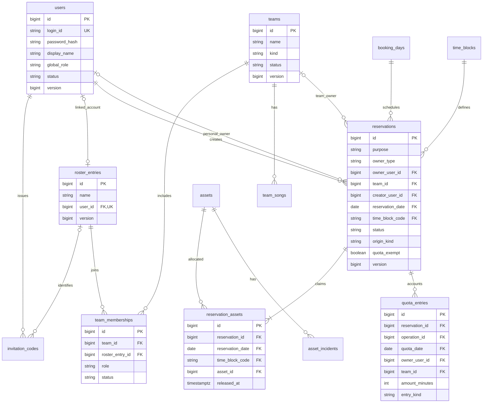
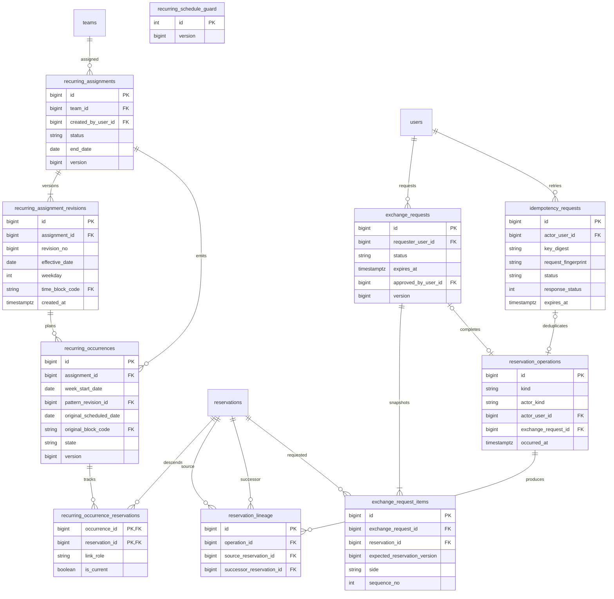
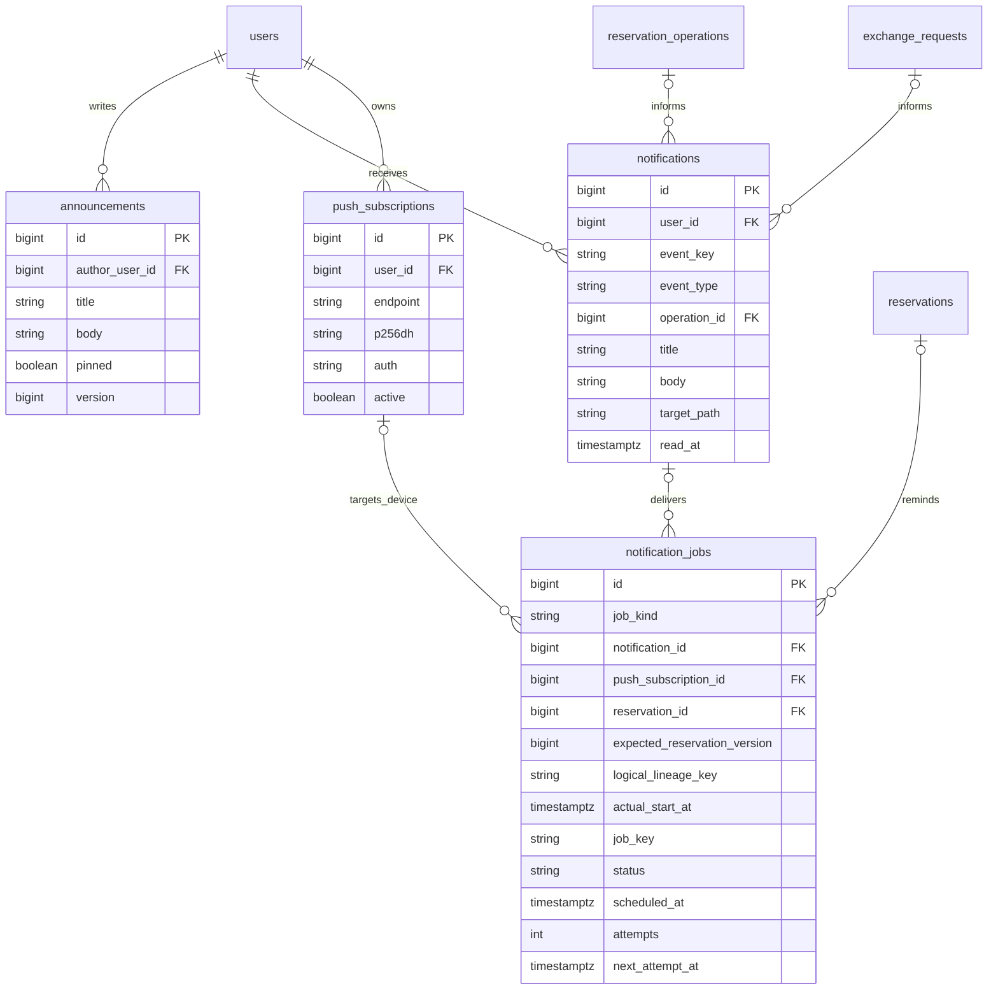

# ERD와 트랜잭션 설계

기준일: 2026-10-10 (Asia/Seoul)

업무 정책의 기준은 [PROJECT_CONTEXT.md](PROJECT_CONTEXT.md), [RESERVATION_RULES.md](RESERVATION_RULES.md)다. 이 문서의 업무 테이블·컬럼·상태·잠금은 정책을 구현하는 **기술 설계 권고안**이다. Flyway V1은 Spring Session JDBC, V2는 `users`·`invitation_codes`·`auth_bootstrap_guard`다. V3는 가입 전 명단·팀·소속·곡과 명단 연결용 초대 FK·잠금·역할 변경 이력을 추가했다. V4는 블록·악기·예약 날짜·예약·점유·한도 ledger·작업 이력·재시도 키를 추가했으며 실제 계약은 [RESERVATION_FOUNDATION.md](RESERVATION_FOUNDATION.md)을 따른다. 이번 V5는 반복 배정·패턴 revision·주차 회차·예약 연결·패턴 guard·관리 재시도 키와 날짜의 `recurring_prepared` 표식을 추가하며 V1~V4를 수정하지 않는다. 실제 V5 계약은 [RECURRING_ASSIGNMENTS.md](RECURRING_ASSIGNMENTS.md)를 따른다. 교환·공지·알림 테이블은 후속 구현이며 아래의 전체 ERD는 완료된 migration 목록과 구분한다. 인증 검증은 [AUTHENTICATION.md](AUTHENTICATION.md), 명단·팀 계약은 [MEMBER_TEAM_MANAGEMENT.md](MEMBER_TEAM_MANAGEMENT.md)를 따른다.

## 1. 핵심 설계 선택

1. 단일 동아리·단일 합주실과 서로 겹치지 않는 열 블록을 모델링한다. 별도 다중 동아리 구조나 30분 atomic slot을 추가하지 않는다.
2. 예약 한 행은 날짜별 고정 블록 한 개다. 120분은 인접한 60분 예약 두 행이다.
3. 팀 예약은 여섯 자원을 모두, 개인은 한 자원을 점유한다. 교환으로 생성한 개인 90분만 두 자원을 허용한다.
4. 자원 점유와 장비 고장은 별도 의미다. 고장이 팀의 방 독점 예약을 차단해서는 안 된다.
5. 날짜별 DB mutex와 자원·개인 활성 예약 unique를 함께 사용한다. aggregate 일일 한도는 날짜 잠금 안에서 ledger로 검증한다.
6. 변경·교환은 원본을 `REPLACED`로 보존하고 후속 예약을 생성한다. 주체·예약자는 복사하고 실제 실행자는 operation에 별도 기록한다.
7. 반복 회차는 패턴 날짜 대신 `assignment_id + week_start_date`로 식별한다. 변경·교환의 N:M 후속 예약과 연결하며 예외를 재생성하지 않는다.
8. 업무 알림과 발송 대기는 상태 변경과 함께 기록하고 Push는 commit 후 worker가 전송한다.

## 2. 회원·팀·예약 ERD

`owner_user_id`와 `team_id` 중 정확히 하나만 사용한다. nullable FK 표시는 개인·팀의 서로 다른 주체를 표현하며 잘못된 null 입력을 허용한다는 뜻이 아니다. `room_id`는 단일 합주실이므로 현재 키에 필요하지 않다. 다중 합주실 확장 시 날짜 mutex·점유 키·API를 함께 변경한다.

## 3. 반복·교환·이력 ERD

`recurring_occurrence_reservations`는 실제 N:M이다. 한 90분 회차를 두 60분으로 나누면 한 회차에서 두 예약으로 이어지고, 두 고정 60분을 한 90분으로 합치면 두 회차가 같은 후속 예약을 가리킬 수 있다.

## 4. 공지·알림 ERD

알림의 예약·교환·공지 참조는 이벤트에 따라 nullable다. 실제 FK 컬럼과 payload를 구현 시 정하되 관계와 중복 방지 키는 유지한다. 알림 수신자는 현재 예약 조작 권한자가 된다는 뜻이 아니다. 상세 발송 동작은 [NOTIFICATIONS.md](NOTIFICATIONS.md)를 따른다.

## 5. 테이블별 계약

### 5.1 users / invitation_codes

- `users`: 로그인 ID, 안전한 비밀번호 hash, 표시 이름, 전역 역할, `ACTIVE/INACTIVE/WITHDRAWN`, 가입·탈퇴 시각, 낙관적 version. `INACTIVE`는 현재 권한 차단을 나타내는 기술 상태다.
- 이메일 필수 여부는 확정 정책이 아니다. 로그인 ID·표시 이름 사용은 기술 제안이며 실제 회원 자료를 문서나 fixture에 넣지 않는다.
- `invitation_codes`: 원문 대신 code digest, 관리용 대상 이름, 발급자, 만료 시각, 사용·해지 시각, 사용한 회원, version. 일회 사용을 원자적으로 보장한다. 재발급은 기존 초대 ID를 명시해 해지와 신규 발급을 한 트랜잭션으로 처리한다.
- V3의 초대 `roster_entry_id`는 명단의 고유 ID를 참조한다. 재발급도 같은 명단 ID를 계승하며 변경할 수 없다. 기존 NULL 초대는 가입·재발급 때 별도 명단 항목을 만들고 이름으로 기존 항목과 합치지 않는다. 같은 명단의 미사용·미해지 초대는 최대 한 건인 unique 제약을 둔다. 가입 후 명단 연결은 계정 생성·초대 소비와 같은 트랜잭션이다.
- 사용자 ID는 예약 이력의 참조다. 탈퇴로 예약 FK와 creator를 삭제하지 않는다. 개인정보 보관·익명화 범위는 별도 운영 검토 대상이다.
- Spring Session JDBC 테이블은 라이브러리 인증 저장소이며 이 업무 ERD와 구분해 migration으로 관리한다.

### 5.2 roster_entries / teams / team_memberships / team_songs

- `teams`: 이름, `REGULAR/ADDITIONAL`, `ACTIVE/DISBANDED`, 생성·해체 시각, version.
- `roster_entries`: 이름, nullable unique `user_id`, 생성·수정 시각, version. 미가입 명단에 로그인 ID·임시 비밀번호를 만들지 않는다. 기존 계정은 관리자가 명시적으로 한 명단에 연결하며 이미 연결된 계정·명단의 재연결은 거절한다.
- `team_memberships`: 팀, `roster_entry_id`, `MEMBER/LEADER`, `ACTIVE/REMOVED`, 가입·제거 시각. 활성 `(team_id, roster_entry_id)` 중복을 금지한다. 가입 후 같은 명단 ID를 통해 계정의 소속을 조회하므로 소속·팀장 배정을 다시 복사하지 않는다. 로그인 권한은 연결된 활성 계정에만 적용한다.
- 팀별 활성 팀장은 최대 한 명이라는 DB 제약을 권고한다. 팀장이 탈퇴하고 후임 지정 전인 상태는 허용하므로 항상 한 명이 있어야 한다는 제약을 만들지 않는다.
- 같은 회원이 여러 활성 정규조·추가조에 소속될 수 있다. 회원별 활성 정규조 수를 한 개로 제한하는 제약·서비스 검증은 두지 않는다. 동일 팀의 활성 `(team_id, roster_entry_id)` 중복 금지와 팀별 역할 검증은 유지한다.
- `team_songs`: 팀, 제목, 선택적 아티스트·메모, 표시 순서, 작성·수정자, version. 전역 음원 카탈로그를 만들지 않고 팀별 목록으로 시작한다.
- 곡 목록 수정자는 전체 관리자 또는 해당 팀장이다.
- 멤버십 변경으로 팀 예약을 자동 삭제하지 않는다. 멤버만 제거하는 경우의 유지 방식은 업무 문서에 제안으로 표시한다.
- `directory_mutation_guard`: 명단·계정 연결·소속·팀장·곡·역할·초대·가입 변경 전에 잡는 singleton 행이다. 잠금 후 현재 실행자 권한을 다시 검사한다. `member_role_audit`는 역할 변경 전후·실행자·시각을 기록한다. 마지막 활성 전체 관리자의 강등은 기술 보호 장치로 거절한다.

### 5.3 time_blocks / assets / asset_incidents

- `time_blocks`: B01~B10, start_minute, end_minute, duration_minutes. [고정 열 블록](RESERVATION_RULES.md#2-운영-시간과-고정-블록)의 매핑을 그대로 저장한다.
- 운영 앱은 블록을 수정·추가하지 않는다. FK와 코드별 정확한 시각 매핑, `end-start=duration`을 개념 제약으로 둔다.
- `assets`: 보컬·건반·일렉기타·베이스·드럼·통기타의 여섯 자원 코드와 표시 이름, 현재 `NORMAL/FAULTY`, version.
- `asset_incidents`: 악기, 내용, 등록자·등록 시각, 복구자·복구 시각, version. 활성 고장 상태와 이력 갱신은 같은 트랜잭션이다.
- 악기 종류 추가는 여섯 자원 전체 점유 불변조건에 영향을 주므로 임의 관리 CRUD로 추가하지 않는다.
- 고장 행은 `reservation_assets`의 점유행이 아니다. 신규 개인 예약은 현재 상태로 검증하고 팀 예약은 안내만 제공한다.

### 5.4 booking_days

- `reservation_date`를 PK로 하는 작은 날짜 mutex 테이블이다.
- 상태는 `PREPARING/OPEN`, 고정 반영 완료 시각, 생성 시각, version을 둔다.
- 운영일은 서울 `LocalDate`이며 24:00 종료가 다음 날짜 mutex에 속하는 것으로 해석하지 않는다.
- 과거 날짜 행을 유지한다. `OPEN` 상태여도 현재 `오늘..오늘+14일` 범위 밖의 생성 요청은 거절한다.
- 없는 날짜는 선행 `directory_mutation_guard`를 보유한 업무 트랜잭션에서 `INSERT ... ON CONFLICT DO NOTHING`으로 생성한 뒤 날짜 오름차순으로 `FOR UPDATE`한다. 없는 행에 `FOR UPDATE`만 호출해서는 잠금이 생기지 않는다.
- V5는 `recurring_prepared` 완료 표식을 추가한다. V4의 기존 날짜는 데이터를 유지하고 표식을 false로 시작한다. 실제 고정 회차 반영과 OPEN 전환을 같은 트랜잭션에서 수행한 뒤에만 일정에서 공개한다. 저장된 OPEN이어도 표식이 false인 날짜는 PREPARING으로 취급한다. 상세 구현 모델은 [RECURRING_ASSIGNMENTS](RECURRING_ASSIGNMENTS.md)를 따른다.

**recurring_schedule_guard:** 주간 패턴 설정을 보호하는 singleton 행을 추가하는 기술안이다. 신규·수정·종료·팀 해체의 패턴 상태 변경은 FOR UPDATE, 날짜 개방의 패턴 읽기는 FOR SHARE를 사용한다. 열린 날짜 밖의 미래 패턴에는 날짜 mutex가 없을 수 있으므로 이 행이 서로 다른 관리자·팀의 충돌 조회와 패턴 저장을 직렬화한다. 일반 예약은 이 guard를 잠그지 않는다.

### 5.5 reservations

| 필드군 | 의미 |
|---|---|
| id, version | 예약 식별과 교환·변경의 stale 요청 검증 |
| purpose, owner_type | `REGULAR/ADDITIONAL/PERSONAL`, `TEAM/PERSONAL` |
| team_id / owner_user_id | 정확히 한 주체; 팀 예약은 팀 종류와 목적이 일치 |
| creator_user_id | 최초 예약자. 후속 예약에도 동일하게 복사 |
| reservation_date, time_block_code | 서울 운영일과 canonical 블록 FK |
| block_start_at, block_end_at | 날짜·블록으로 서버가 계산한 시각 snapshot |
| usable_from | 잔여 시간 예약을 포함한 예약 효력 시작 |
| status | `CONFIRMED/CANCELED/REPLACED` |
| origin_kind | `MANUAL/FIXED/CHANGE/EXCHANGE`; 생성 경로 audit |
| quota_exempt | 원래 직접 고정 60분만 true; 사용자 후속 60분에는 전파하지 않음. 90분은 면제 표시 없이 한도 비대상 |
| dual_asset_exception | 교환으로 생성된 90분 개인 예외인지 표시 |
| created_at, canceled_at, cancel_reason | 생성·취소 이력 |

- `block_start_at/block_end_at`은 자유 입력이 아니다. 고정 FK와 서울 날짜로 계산하고 일관성을 검증한다.
- 종료 표시 `ENDED`는 현재 시각과 end로 계산하는 조회 상태다. 정상 종료를 `CANCELED`로 바꾸거나 사용 이력을 삭제하지 않는다.
- 원래 creator가 탈퇴했어도 존속 팀 예약은 존재할 수 있다. 현재 실행자와 팀 상태를 검증하며 역사적 creator의 탈퇴를 팀 예약 삭제 조건으로 삼지 않는다.
- 개인 `CONFIRMED` 예약의 `(owner_user_id, reservation_date, time_block_code)`는 unique다. 두 악기 예외도 예약 한 행이므로 이 조건을 만족한다.

내 공연조 일정(`/my-schedule`)은 별도 일정 테이블이나 미래 패턴 복제 없이 기존 `reservations`와 현재 활성 `team_memberships`를 사용한다. 서버의 `scope=mine` 응답 가운데 현재 소속 팀의 `owner_type=TEAM`, `status=CONFIRMED` 실제 예약만 표시하고 날짜의 `OPEN/recurring_prepared` 상태를 함께 확인한다. 일반 예약과 고정 회차는 `origin_kind`로 구분한다. `recurring_occurrences`의 PLANNED만 있는 회차는 확정 예약 목록에 포함하지 않으며 취소·교체 이력과 계보는 기존 모델에 남긴다. 화면의 시간순 정렬·팀 필터·상태 표시는 조회 표현이며 V5 이후 새 migration을 추가하지 않는다.

### 5.6 reservation_assets

- 예약, 악기, 서울 날짜, 블록, claim_kind, created_at, released_at을 기록한다.
- 같은 예약·악기를 두 번 연결하지 않는다.
- `released_at IS NULL`인 행의 `(reservation_date, time_block_code, asset_id)`를 unique로 한다.
- 날짜·블록은 부모 예약과 일치하도록 복합 FK 또는 동등한 제약을 적용한다. 부모 상태를 child partial index 조건에서 조회하지 않는다.
- 취소·교체는 점유행을 삭제하는 대신 `released_at`을 설정한다. 원래 선택한 악기 이력을 보존한다.
- 팀은 여섯 점유, 일반 개인은 한 점유, 90분 개인 예외는 서로 다른 두 점유를 생성한다. 필요한 점유 전체 생성과 부모 상태 전환은 한 트랜잭션이다.
- 행 수 완전성은 단순 unique만으로 보장되지 않는다. 날짜 잠금 안의 Service와 실제 DB 테스트로 여섯 자원·최대 두 악기 규칙을 검증한다.
- 정상 종료한 날짜의 점유행은 역사적 점유를 나타낸다. 현재 충돌 조회는 날짜·블록·예약 유효 상태를 함께 사용한다.

### 5.7 quota_entries

- 예약, operation, 개인/팀 주체, 서울 quota_date, `amount_minutes`, entry_kind, 생성 시각을 보존한다.
- 일반 60분 생성은 `+60`, 시작 전 취소·교체는 해당 소비의 `-60`이다.
- 최초 `RESERVE` 항목은 일반 60분에 `+60`, 면제·90분에 `0`을 기록하는 안을 채택한다. 예약의 면제 snapshot과 함께 소비 근거를 보존한다.
- 시작 후 취소는 복구 항목을 만들지 않는다. 서버가 처리 시점과 블록 시작 시각을 비교한다.
- 예약별 최초 `RESERVE`와 소비 복구 `RELEASE`를 각각 최대 한 번 기록한다. 복구 사유로 취소/교체를 구분하고 동일 취소·재시도·교환이 중복 복구를 만들지 않는다. 소비가 0인 예약에는 음수 복구가 없다.
- 현재 한도는 주체·quota_date별 전체 ledger 합이며 0~120분이다. 과거 시작 후 취소 소비도 포함한다.
- aggregate 합계는 단순 행 CHECK/unique로 보장할 수 없다. 해당 날짜 mutex 안에서 기존·새 예약의 순변화를 계산하고 최종 합계가 유효할 때만 commit한다.
- 변경·교환은 기존/새 날짜 전부를 잠그므로 중간 복구 상태를 다른 요청이 이용할 수 없다.

### 5.8 reservation_operations / reservation_lineage

- `reservation_operations`: CREATE, CANCEL, CHANGE, EXCHANGE, FIXED_GENERATE, SERIES_UPDATE, USER_WITHDRAW, TEAM_DISBAND 같은 논리 업무, 실제 실행자 또는 SYSTEM, 시각, 이유, exchange_request 참조.
- `reservation_lineage`: operation별 원본 예약과 후속 예약의 방향 있는 연결. source와 successor의 주체·creator는 같다.
- 1:1 변경에도 원본을 REPLACED로 보존한다. 실제 예약 날짜·블록·악기를 과거 행에 덮어쓰지 않는다.
- 교환 lineage는 소유자를 교차 연결하지 않는다. A의 원본은 A의 후속으로, B의 원본은 B의 후속으로 연결한다. 목적지 시간만 상대 그룹에서 가져온다.
- 묶음 교환의 2→1, 1→2를 표현할 수 있으며 원본 creator가 같다는 전제 때문에 후속 creator도 모호하지 않다.
- API는 `replacedReservationIds`, `reservations[]`, 교환이면 `exchangeRequestId`를 반환한다. 클라이언트는 새 ID를 사용하고 오래된 ID를 최신 예약으로 오인하지 않는다.
- 날짜·블록·악기가 모두 같은 PATCH는 no-op다. 원본 상태·ID·면제·고장 등록 전의 기존 예약 지위를 유지하고 변경 알림을 새로 만들지 않는다.
- CHANGE/EXCHANGE의 후속 행 각각에 일반 CREATED 알림을 추가하지 않는다. 논리 작업 단위의 변경/교환 알림과 새 시작 알림을 만든다.

### 5.9 recurring_assignments / revisions / occurrences

- `recurring_assignments`: 팀, 원래 관리 발급자, ACTIVE/ENDED, version. 한 assignment는 한 주의 한 블록 배정이다. 인접 두 60분 고정 배정은 두 assignment로 구성할 수 있다.
- `recurring_assignment_revisions`: 적용 시작일, 요일, 블록, revision 번호, 승인 시각 `created_at`. 과거 패턴 이력을 수정하지 않고 새 revision을 추가한다. 시작 전 경계 판정은 저장된 승인 시각으로 고정하며 지연 복구 시각으로 이전 패턴을 되살리지 않는다. V5의 포함 종료일은 assignment에 저장하며 관리 version과 작업 이력으로 종료 변경을 기록한다.
- `recurring_occurrences`: assignment, 서울 월요일 week_start_date, 패턴 revision, 원래 관리자 예정 위치, 상태, version.
- `(assignment_id, week_start_date)`는 unique이며 패턴 revision과 실제 예약 날짜를 키에 넣지 않는다.
- 상태는 `PLANNED/MATERIALIZED/CANCELED_EXCEPTION/CHANGED_EXCEPTION/EXCHANGED_EXCEPTION/ENDED`를 제안한다.
- `recurring_occurrence_reservations`는 회차와 원본·후속 예약을 N:M으로 연결하고 현재 연결을 구분한다. 취소·변경·교환 tombstone은 유지한다.
- 예외가 있는 회차는 자동 생성·전체 패턴 수정으로 초기 위치에 다시 만들지 않는다.
- 관리자 패턴 변경의 예외 없는 새 직접 배정은 새 원래 위치에서 FIXED 면제를 받을 수 있다. 사용자 변경·교환 lineage는 FIXED 생성으로 둔갑시키지 않는다.
- 적용 기간이 겹치는 미래 주간 패턴의 요일·블록 충돌도 검사한다. 아직 booking_days가 없는 미래라고 중복 고정 배정을 허용하지 않는다.
- 일반 종료는 종료일 이후의 미시작·예외 없는 직접 배정을 정리하고 변경·교환 후속 및 예외 이력을 유지하는 기술안이다. 종료일 당일까지의 회차는 계속 유효하며 미래 종료일은 날짜 조건으로 생성에 반영한다. 팀 해체의 전체 남은 예약 취소와 구분한다.

**요일 변경 예:** 원래 수요일 회차를 그 주 금요일로 사용자가 변경했다면 해당 주차는 CHANGED_EXCEPTION이다. 관리자가 패턴을 목요일로 바꿔도 그 주의 목요일 예약을 새로 만들지 않는다. 다음 예외 없는 적용 가능 주차부터 새 패턴을 사용한다.

**경계 주차 기술안:** 적용 시작일이 포함된 주에서는 기존 예정일과 새 예정일이 모두 적용일 이후이고 미시작·예외 없음인 회차만 변경한다. 하나가 적용일 이전이면 기존 회차를 유지한다. 이미 시작·종료한 회차는 보존하고 다음 적용 가능한 주차부터 새 패턴을 적용한다. 이 기준은 같은 assignment의 한 주에 두 자동 회차를 만드는 일을 막는 권고안이다.

### 5.10 exchange_requests / exchange_request_items

- request: 요청자, `PENDING/COMPLETED/REJECTED/CANCELED/EXPIRED/INVALIDATED`, 가장 이른 블록 시작 expires_at, 승인자·처리 시각, version.
- item: request, REQUESTER/COUNTERPART 측, source reservation, expected reservation version, 그룹 순서. `(request_id, reservation_id)`와 측별 순서 중복을 금지한다.
- 선택한 두 악기의 60분 분배는 target 순서별 asset mapping snapshot으로 저장한다. 원래 자원 집합 전체를 유지하면서 각 target 60분에 하나씩 배분했는지 검사한다.
- PENDING은 새 점유를 잡지 않는다. 원본 예약은 CONFIRMED 상태로 유지한다.
- 원본이 변경·취소·해체되거나 요청자가 현재 권한을 잃으면 INVALIDATED다.
- 특정 승인 후보 한 명이 팀장을 그만두거나 탈퇴한 것만으로 다른 적법한 승인 후보의 가능성까지 없애지 않는다. 권한 없는 승인 행위는 403이며 현재 다른 적법한 승인자는 재검증 후 승인할 수 있다.
- source가 유효한데 새 위치의 자원·고장·한도 검증만 실패하면 예약을 바꾸지 않고 충돌 응답을 반환한다. request는 만료·무효 조건을 따로 판단한다.
- 승인은 업무 전체 commit 시에만 COMPLETED다. APPROVED 후 별도 비원자적 이동 단계는 두지 않는다.

### 5.11 announcements / notifications / notification_jobs / push_subscriptions

- `announcements`: 제목·본문·중요 고정, 전체 관리자 작성자, 작성·수정 시각, version. 조별 공지를 추가하지 않는다.
- `notifications`: 사용자별 업무 알림, event_key·유형, 논리 operation/교환/공지 참조, 표시 문구, 내부 이동 대상, read_at. `(event_key, user_id)` 중복을 금지한다.
- `notification_jobs`: job_kind, job_key, 대상·예상 버전, scheduled_at, 처리 상태, 시도 수, lease/처리 시각, next_attempt_at, 오류 분류. 동일 job_key를 중복 생성하지 않는다.
- `REMINDER_PLAN`은 미래 시작 알림 계획이다. 계획 단계에는 notification_id와 push_subscription_id가 null이다. due 시 현재 예약·버전·시각·수신 자격을 확인한 뒤 알림함 항목과 기기별 PUSH_DELIVERY를 생성한다. 미래의 "곧 시작" 알림을 알림함에 미리 노출하지 않는다.
- `PUSH_DELIVERY`는 이미 생성한 알림의 구독 하나에 대한 전송이다. notification_id와 push_subscription_id를 모두 사용하며 `(event_key, push_subscription_id)`로 중복을 억제한다. 한 기기의 성공이 다른 기기의 작업을 SENT로 바꾸지 않는다.
- job 상태는 `PENDING/PROCESSING/RETRY_WAIT/COMPLETED/SENT/FAILED/CANCELED`를 제안한다. COMPLETED는 reminder 계획의 업무 이벤트 생성 완료, SENT는 개별 기기 전송 성공이다. 단말 실제 표시 성공까지 의미하지 않는다.
- 업무 취소·교체에 따른 무효화는 CANCELED와 canceled_at/사유로 표시한다. 만료 lease는 복구하되 CANCELED 작업을 다시 대기 상태로 되살리지 않는다.
- `push_subscriptions`: 사용자 소유 endpoint, p256dh/auth 발송 키, 활성 여부, 생성·갱신·만료 시각. endpoint 중복을 막고 계정 전환을 처리한다.
- 시작 알림의 due는 블록 시작 한 시간 전이다. 지난 시점은 소급 등록하지 않는다. 예약 ID·버전은 현재 배치 검증과 오래된 계획 무효화에 사용하며 단독 중복 식별키로 쓰지 않는다.
- 기술안: 동일 주체의 논리 계보와 실제 block_start_at을 reminder identity로 사용한다. 계보는 reservation_lineage를 통해 구한 최초 원본 root IDs의 정렬·중복 제거 집합으로 표현하고 job에 logical_lineage_key/root IDs와 actual_start_at을 보존한다.
- N:M 병합·분할로 root 집합 표현이 바뀌는 경우에도 같은 원본 계보의 같은 시작 알림을 새 ID라는 이유로 재발송하지 않는다. 같은 주체·시작 시각에서 원본 root 집합이 겹치는 기존 계획·발송 이력을 검사하는 안을 권고한다. 집합 hash unique 하나만으로 이 조건을 보장한다고 주장하지 않는다.
- 변경이 같은 시작 시각이면 미전송 계획의 현재 대상·version만 대체하고 이미 보낸 시작 알림은 반복하지 않는다. 병합·분할·원래 시간 복귀·여러 기기 사례에서 root 매칭과 key 규약을 구현 전 회귀 시나리오로 검증한다. 이는 새 사용자 운영 질문이 아니라 기술 구현 검증이다.
- 변경·교환·취소는 이전 job을 무효화하고 후속 예약의 새 job을 같은 트랜잭션에서 등록한다.
- commit 이후 worker는 활성 회원·팀 소속·예약 버전·구독을 재검증한다. 외부 Push 호출 동안 예약 mutex를 잡지 않는다.
- worker 중복 실행은 job 행 claim/lease와 unique 키로 막는다. 외부 전달의 end-to-end exactly-once를 보장한다고 표현하지 않는다.

### 5.12 idempotency_requests

이 테이블은 `Idempotency-Key`를 사용하는 mutation의 기술 권고안이며 새로운 예약 한도를 추가하는 정책이 아니다.

- 실행자 scope, key digest, HTTP method·route, request fingerprint, 처리 상태, 응답 status·결과 예약 ID/operation 참조, 생성·만료 시각을 보존한다.
- 실행자와 key의 조합을 unique로 하고 method·route·본문 fingerprint를 함께 검증한다. 다른 요청으로 같은 key를 재사용하면 IDEMPOTENCY_KEY_REUSED다.
- 중복 요청을 판별하는 단계는 주체·날짜 잠금보다 앞에 두고, 동시에 들어온 같은 key는 먼저 실행한 트랜잭션의 결과를 확인한다.
- 완료 결과와 예약·operation 쓰기를 같은 트랜잭션에서 확정한다. 응답 손실 후 재시도에도 동일한 후속 예약 ID를 반환한다.
- `reservation_operations`는 선택적으로 idempotency_request_id를 참조한다. 예약 이외의 초대·공지·팀 관리도 공통 저장소를 사용할 수 있다.
- 실패 트랜잭션의 임시 IN_PROGRESS를 성공 기록으로 보존하지 않는다. TTL·오류 결과 재사용 범위는 API 공통 구현 계약으로 정한다.
- 같은 key의 중복 억제가 현재 권한·날짜·점유 검증을 대체하지 않는다. 캐시된 민감 응답을 반환하기 전에도 현재 인증을 검사한다.
- 시스템 반복 생성·알림 worker는 회차 key와 job_key로 멱등성을 보장한다. 외부 요청 key가 있어야만 작동하는 구조로 만들지 않는다.

## 6. 잠금 프로토콜

### 6.1 권장: 날짜 행 mutex

한 날짜의 작은 시간표 전체를 직렬화한다. 슬롯별 락·분산 락·복잡한 조건별 잠금보다 설명과 검증이 쉽다. 날짜가 다른 작업은 관련 회원·팀·악기 잠금이 허용하는 범위에서 진행한다. 45명 규모에서 commit까지 짧게 유지하는 것을 우선한다.

모든 예약·권한·고정 배정·고장 상태 변경 경로는 다음 순서를 지킨다.

| 순서 | 대상 | 취득 기준 |
|---:|---|---|
| 0 | 사전 입력·계획 및 directory_mutation_guard | 형식·필요 대상 집합을 읽고 guard를 먼저 잠근다. 현재 회원·소속·역할과 재시도 권한을 다시 검사한다 |
| 1 | users, teams | 관련 user ID 오름차순, 다음 team ID 오름차순. 주체뿐 아니라 actor·approver·권한 변경 대상 포함 |
| 2 | assets | 관련 asset ID 오름차순. 신규/이동의 고장 검사에는 FOR SHARE, 고장 등록·복구는 FOR UPDATE |
| 3 | recurring_schedule_guard | 패턴 쓰기는 FOR UPDATE, 날짜 개방은 FOR SHARE. 일반 예약은 생략 |
| 4 | booking_days | guard 안에서 없는 행을 ensure한 뒤 기존·새 예약·한도·반복 적용의 모든 날짜 오름차순 FOR UPDATE |
| 5 | reservations 및 관련 업무 행 | reservation ID 오름차순 잠금, 교환/회차 version 재검증 |
| 6 | 실제 쓰기 | 원본 release, 후속 insert, quota, 회차/교환 상태, 알림/outbox를 원자적으로 기록 |

- users/teams는 PK를 변경·삭제하지 않고 탈퇴·해체 상태로 보존한다. PostgreSQL `FOR NO KEY UPDATE`를 기본 subject mutex로 권고한다. 회원 상태·멤버십 변경과 예약 권한 검사를 직렬화하면서 알림 수신자 FK의 KEY SHARE와 불필요하게 충돌하지 않는다.
- JPA의 PESSIMISTIC_WRITE가 FOR UPDATE로 동작한다면 알림 수신자까지 초기 사용자 잠금 집합에 넣고 변경된 수신자를 재검증하거나, 명시적 subject 잠금 쿼리로 위 모드를 유지해야 한다. FK 대기까지 고려하지 않고 뒤늦게 사용자 잠금을 추가하지 않는다.
- 한 트랜잭션에서 필요한 가장 강한 잠금 모드를 처음부터 선택한다. 같은 행을 먼저 SHARE로 잡고 뒤늦게 UPDATE로 올리는 경합을 피한다.
- 원본 예약의 날짜·version·대상 집합이 바뀌면 정해진 순서 밖에서 새 락을 추가하지 않는다. rollback 후 최신 계획으로 재시도하거나 stale 응답을 반환한다.
- 날짜 개방도 subject/asset 잠금 후 recurring guard SHARE를 얻어 패턴 목록을 다시 확인한다. 처음 계획한 팀·사용자 집합과 달라졌다면 공통 기준에 따라 rollback 후 다시 계획한다. 팀 해체의 시리즈 종료와 일괄 패턴 수정은 guard UPDATE에 참여한다.
- unique 위반 후 같은 실패 트랜잭션 안에서 정상 후속 처리를 계속하지 않는다. rollback 완료 후 오류를 매핑한다.

### 6.2 각 mutation 경로

| 경로 | 반드시 함께 보호할 상태 |
|---|---|
| 생성 | actor/주체 활성 상태, 회원의 팀 소속, 선택 악기 상태, 날짜 개방, 자원·개인 점유, 해당 날짜 quota |
| 취소 | 현재 actor 권한, 원본/날짜, 시작 전후 경계, 점유 release, quota 복구 1회, 관련 교환/job |
| 변경·교환 승인 | 모든 주체·actor/approver, 원본/목적지 악기, 원래/새 날짜 quota, 모든 원본 버전, 제3자 점유 |
| 고정 배정·전체 수정 | admin과 대상 팀, 영향을 받는 날짜, 회차 주차 key와 예외, 기존 선착순 예약 |
| 날짜 개방·복구 | 대상 팀/회차 상태, 고정 생성, 동일 날짜 OPEN 전환; 중복 worker의 unique/락 |
| 회원 탈퇴 | 해당 사용자·actor, 개인 예약 날짜/자원, 요청자 자격, job/구독; 존속 팀 예약 유지 |
| 팀 해체 | team/actor, 안정적으로 조회한 미래·진행 중 팀 예약 날짜, 시리즈 종료와 request/job |
| 팀 구성·팀장 변경 | actor, 대상 users와 team의 같은 초기 잠금 순서. 팀 예약 자체를 무조건 취소하지 않음 |
| 고장 등록·복구 | admin과 해당 assets. 점유를 자동 취소하지 않으며 개인 새 배치 검사와 commit 순서를 확정 |

주체 잠금을 먼저 얻기 때문에 팀 해체가 안정적으로 대상 예약을 조회할 수 있다. 같은 팀의 새로운 예약·자동 생성은 해체 트랜잭션이 끝난 뒤 최신 상태를 보고 거절된다. 초기 목록에 없던 날짜의 예약이 그 사이 들어와 취소를 빠져나가게 만들지 않는다.

### 6.3 장애 상태와 commit 경계

- 개인 예약/새 배치가 asset SHARE를 먼저 얻으면 고장 등록 UPDATE는 기다린다. 예약이 먼저 commit하면 고장 등록 전 기존 예약으로 유지한다.
- 고장 등록이 먼저 UPDATE를 얻고 commit하면 예약 검사는 최신 FAULTY를 보고 거절한다.
- rollback한 고장 등록은 고장으로 취급하지 않는다.
- 팀 예약은 고장 때문에 실패하지 않지만 안내 snapshot과 최신 조회를 제공한다.

### 6.4 advisory lock 대안과 한계

PostgreSQL transaction advisory lock을 `고정 namespace + 서울 날짜의 epoch-day`에 적용하는 대안도 있다. 여러 서버에 적용되고 트랜잭션 종료 시 해제된다. 다만 없는 날짜의 개방 상태를 저장하지 못하며 key 규약과 모든 쓰기 경로의 협력이 필요하다. 현재는 `booking_days`로 개방 상태와 mutex를 함께 표현하는 안을 권고한다. 두 락 방식을 임의 혼용하지 않는다.

READ COMMITTED에서 날짜 mutex와 unique를 사용하는 것으로 시작한다. JVM 락이나 단순 exists 조회를 최종 보장으로 삼지 않는다. 자원 unique는 DB 방어선이지만 ledger 합계, 여섯 claim 완전성, 회차 예외는 공통 트랜잭션 프로토콜과 테스트가 함께 보장한다.

## 7. 트랜잭션별 불변조건

| 불변조건 | 보장 위치 |
|---|---|
| 예약은 열 고정 블록 중 하나 | block FK, 정적 mapping, 서버 입력 검증 |
| 같은 악기 활성 점유 한 건 | reservation_assets partial unique |
| 개인 같은 시간 예약 한 건 | reservations 개인 CONFIRMED partial unique |
| 팀은 전체 독점 / 개인 예외 최대 두 | 서버가 정확한 claim 집합 생성 + 날짜 mutex + 전체 rollback |
| 날짜별 일반 60분 합계 최대120 | 날짜 mutex + quota ledger 최종 합 검증 |
| 한도 복구 한 번 | 예약별 ledger event unique + 예약 version/상태 |
| 고정 회차 중복·예외 재생성 없음 | assignment/week unique + occurrence tombstone/lineage |
| 미개방 미래 패턴끼리 중복 없음 | recurring_schedule_guard + 적용 기간·요일·블록 충돌 재검증 |
| 교환 대상이 stale하지 않음 | item expected version + 원본 row lock + 만료/권한 재검증 |
| 교환·변경 실패 시 양측 보존 | 단일 DB transaction, commit 이후 성공 응답 |
| 알림 항목/발송 작업 중복 억제 | event/user unique, job_key unique, worker claim |
| 탈퇴·해체 후 새 잘못된 예약 없음 | 현재 users/teams 상태와 동일 subject 잠금 규약 |

## 8. 날짜·보존·개인정보

- 운영 날짜와 quota 날짜는 DB `date`, Java `LocalDate`다.
- 감사·만료·예정 발송·실제 시각은 `timestamptz`/Instant다. PostgreSQL이 원래 시간대 이름을 자동 보존한다고 가정하지 않는다.
- 서울 날짜와 `end_minute=1440`을 다음 날 00:00으로 해석한다. UTC 기준 자정이나 서버 OS 시간대로 날짜 개방을 계산하지 않는다.
- 사용자·팀·원본 예약·회차·ledger는 soft 상태 또는 이력으로 보존한다. 운영 종료 시 백업하고 실제 개인정보 보관 범위는 운영 문서에서 검토한다.
- 공개 범위는 아직 업무 확정 사항이 아니다. 권고안은 활성 인증 회원에게 일정 정보를 제공하고 로그인 ID, 초대 digest, password hash, endpoint/auth key를 일정 응답에 노출하지 않는 것이다.
- 실제 이름·이메일·구독 값은 예제 ERD, 테스트 데이터, Git 문서에 넣지 않는다.

## 9. 구현 전 검토·검증 기준

- API의 상태·ID·version과 위 테이블 용어를 맞춘다.
- fresh DB migration과 테스트 DB schema를 같은 Flyway 경로로 만든다. 현재 문서는 migration이 아니다.
- 각 worker/스레드는 별도 DB 연결·트랜잭션을 사용하고 fixture를 먼저 commit한다.
- 경합 테스트 barrier는 INSERT 전에 둔다. 충돌 INSERT 후 barrier는 대기 중인 상대 때문에 멈출 수 있다.
- 연결 pool 크기와 테스트 참가 수를 맞추고 성공 수는 commit 이후 집계한다.
- 개인 서로 다른 악기 동시 성공, 같은 악기 한 건 성공, 팀 대 개인 배타, quota 초과 경합, 고장 commit 순서를 검증한다.
- 1:2 교환의 부분 INSERT 실패, 승인 대 취소/변경, 회차 주차 보존, 날짜 OPEN 복구, 탈퇴/해체 경합을 검증한다.
- 중복 request·job·반복 작업을 재실행해 동일 상태와 이력을 유지하는지 확인한다.
- 상세 시나리오는 [TEST_PLAN.md](TEST_PLAN.md)를 따른다. 문서 작성만으로 DB 경합 테스트 통과나 실제 Push·백업 복구 완료를 주장하지 않는다.

## 10. PostgreSQL 근거

- [Partial indexes](https://www.postgresql.org/docs/current/indexes-partial.html): 테이블 자체 컬럼 조건으로 활성 행 unique를 적용한다. 부모 상태를 child predicate에서 조회하지 않는다.
- [Explicit locking](https://www.postgresql.org/docs/current/explicit-locking.html): FOR NO KEY UPDATE/SHARE/UPDATE의 충돌 관계, transaction 해제, 순서 및 advisory 대안.
- [Index uniqueness checks](https://www.postgresql.org/docs/current/index-unique-checks.html): 미확정 INSERT/DELETE의 commit·rollback에 따른 충돌 재판정.
- [Constraints](https://www.postgresql.org/docs/current/ddl-constraints.html): cross-row aggregate를 CHECK로 우회하지 않고 FK·unique·트랜잭션으로 분리한다.
- [Date/time types](https://www.postgresql.org/docs/current/datatype-datetime.html): 운영일과 실제 시각 타입을 구분한다.
